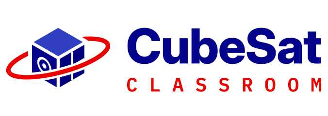
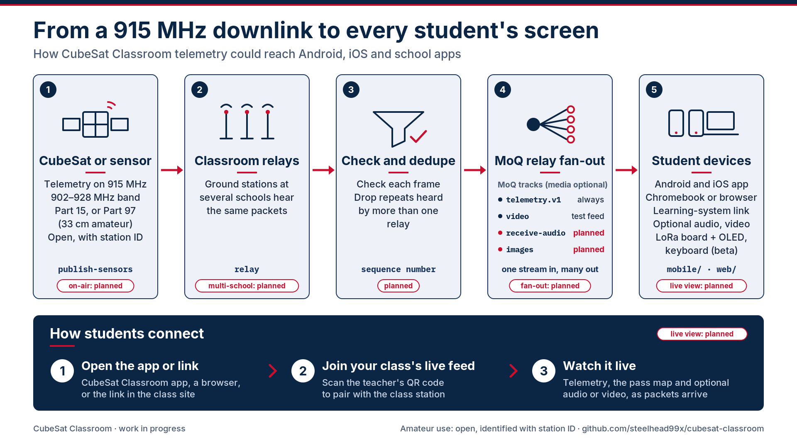

# CubeSat Classroom

<picture>
  <source media="(prefers-color-scheme: dark)" srcset="docs/assets/cubesat-classroom-wordmark-reversed.svg">
  
</picture>

CubeSat Classroom helps teachers bring space science into the classroom through free, open-source quests. Learners request a sensor reading, receive test video, and see what happens when the link drops. The browser simulator gives every crew a place to start.

The Summer 2027 briefing describes the project’s goals for teacher training and classroom access. The [fork guide](docs/fork-guide.md) shows how to adapt the kit for a class, club, or mission. [Mission briefing](https://hikd.ai/tis/) · [Brand kit (review access)](https://hikd.ai/tis/brand/)

> **Status: work in progress.** This is an early, volunteer-run project. Everything here runs as a desk simulation or a bench test. Nothing has flown, no flight is booked, and no radio hardware in this repository has been reviewed for on-air use. Expect breaking changes.

[](docs/images/915-to-students.svg)

*How CubeSat Classroom telemetry could reach student devices; the steps marked planned are not built or measured yet.*

## What works today, and what is planned

| Works today (simulation or bench) | Planned, not built or not verified |
| --- | --- |
| Ground station on localhost: commands, simulated sensors, test video over Media over QUIC | Over-the-air operation with a licensed station |
| Desk simulation of a cleartext 915 MHz frame, plus a telemetry-first fan-out on loopback | A beta LoRa OLED board, and any measured classroom fan-out |
| Pass prediction from TLEs, suborbital flight-profile desk simulation | Any balloon, suborbital or orbital flight |
| Sensor bridge for Arduino, XIAO and Raspberry Pi readings | Classroom fan-out and relay mesh between schools (not measured) |
| Five browser lessons, Expo mobile app (offline) | Hosted AI quest guide, adult sign-in and paid plans (proposals only) |
| [Printable 1U frame](hardware/amsat-cubesatsim/README.md): AMSAT's CubeSatSim frame with a 100% printed plate for an Arduino Uno R3 and Nano 33 BLE Sense. CAD checks pass and the snap test printed well on a P1S | A fully assembled frame with both boards fitted |
| | [Bench CubeSats](docs/bench-cubesats.md) for Arduino and Seeed XIAO: firmware and guide written, not yet compiled with the board packages or run on hardware |

## Who it's for

CubeSat Classroom is written for learners 13 and up, and for the teachers, guardians and mentors who guide them. Every level of learning and experience is welcome, from a first question to decades of engineering, teaching or radio work.

- **No account is needed** for the browser lessons, the mobile app or the local ground station.
- **To join the project** (comment, share a crew log, propose a change), use an account on a hosted Git service: GitHub, GitLab.com or Codeberg. Self-hosted Git servers are not supported. The main repository is on GitHub today, but you are not locked in to it. Work from a fork or mirror on the host you prefer and send a link to your branch, or a patch.
- **Students** may use their own account if they are old enough under that host's terms. GitHub, for example, requires users to be at least 13.
- **Teachers, guardians and mentors** can use their own accounts to guide the lessons and the project: they open issues, review changes and share results for their crew. Younger learners take part only alongside one of these adults, who stays for the whole activity and never shares a login with anyone under 13. Younger learners never need an account of their own. The [mentor quests](quest/README.md#mentor-quests) show how.
- **No Git account?** The planned sign-in for the hosted app will also let teachers, guardians and mentors sign in with a phone number. Students sign in with a Git account or join through an adult; the project does not collect students' phone numbers.

## Demo

Start with [Make first contact](https://cubesatclass.org/quests/first-contact/). The browser exercise uses simulated data and needs no account or hardware.

The Rust ground station runs on macOS, Linux, and Windows via WSL (Windows Subsystem for Linux).

- [Start with Claude, Codex, Grok, or another AI assistant](docs/quick-start.md#with-an-ai-assistant).
- Or run the guided installer in your terminal.

```sh
curl -fsSL https://cubesatclass.org/start.sh | bash
```

If that address asks for a password, the site is in private preview: clone this repository and run `bash docs/start.sh` instead.

The starter walks you through setup. Open the loopback address it prints. The station uses two local Media over QUIC relays to send commands and return readings and video.

To run the same checks as CI from a clone:

```sh
cargo fmt --check && cargo clippy --locked --all-targets -- -D warnings && cargo test --locked
(cd site && npm ci && npm run build && npm test)
(cd mobile && npm ci && npm run typecheck && npm run lint)
```

[Five-minute demo run sheet](docs/demo-run-sheet.md) · [Printable quick start](output/pdf/cubesat-classroom-quick-start.pdf) (rebuild with `python3 scripts/quick_start_pdf.py`)

## Labs and quests

| Start with | What to do |
| --- | --- |
| [Browser lessons](https://cubesatclass.org/quests/) | Five lessons cover measurement, pictures, link loss, reading age, and light levels. |
| [Bench CubeSats](docs/bench-cubesats.md) | Build a one-vendor classroom CubeSat from an Arduino Nano 33 BLE Sense Rev2, or from a Seeed XIAO with Grove sensors. Deploy it, lose and regain the signal, and bring back stored readings or a photo. |
| [Ground station build guide](docs/ground-station.md) | Connect classroom sensors, predict a pass, or plan a receive-only station. |
| [Print a 1U CubeSat](hardware/amsat-cubesatsim/README.md) | AMSAT's CubeSatSim frame with a printed payload plate for an Arduino Uno R3 and Nano 33 BLE Sense. Four P1S plates, about 4 hours, no screws. |
| [Hardware](hardware/README.md) | The AMSAT and Teachers in Space frames, the Rev A test box and screw-fit coupon, and the Rev B rail frame. |
| [Suborbital flight plan](docs/suborbital-flight-plan.md) | Get a classroom sensor kit ready for a suborbital research flight, using public information. Predict the flight with `flight-profile`. |
| [Flight heritage quests](quest/README.md#flight-heritage-and-the-suborbital-research-flight) | Learn from the Perlan 2 glider and the ISS, then compare all three rides. |
| [Balloon lab](docs/balloon-lab.md) | Compare classroom pressure and temperature with archived flight data. |

The [quest board](quest/README.md) includes demo rehearsals, sensor tests, and hardware reviews. Share settings, measurements, and what another crew should check next. [Contribution guide](CONTRIBUTING.md)

## Rust tools

The ground station (`src/`) and the design-review budgets (`crates/mission-budget/`) are one Cargo workspace. Still in progress: the budgets are planning numbers for review, not measurements or flight predictions.

```sh
cargo run --locked -- link-budget hardware/rf-example.json   # downlink sensitivity exercise
cargo run --locked -- energy-budget                          # battery budgets for the station and balloon payloads
cargo fmt --check && cargo clippy --locked --all-targets -- -D warnings && cargo test --locked
```

Run `cargo run --locked -- --help` to list every subcommand. They fall into three groups:

- **Offline calculators:** `passes` (SGP4 pass prediction from a TLE file), `flight-profile`, `link-budget`, `energy-budget`, and `downlink-sim`. Each has `--json` except where noted. `downlink-sim` is a virtual 915 MHz loss exercise, not a radio test.
- **Local station:** `classroom`, `relay`, `simulate`, `publish-sensors`, `read-telemetry`, `live-feed`, `read-live`, and `verify-video`. The `classroom` and `relay` servers listen on loopback only. `live-feed` publishes a desk-simulated downlink onto Media over QUIC tracks. The client contract is [docs/client-contract.md](docs/client-contract.md).
- **Sensors:** `sensor-bridge` and `balloon-log`.

None of them transmit on radio. The website and Worker (`site/`), the mobile app (`mobile/`) and the CAD and PDF generators stay in their own languages for now.

## Project links

[Classroom site](https://cubesatclass.org/) · [CubeSat Club](https://cubesatclass.org/volunteer/) · [Mobile template](mobile/README.md) · [Mission and radio design](docs/mission.md)

## Radio and safety

- This repository does not transmit on its own. The station and demos use loopback relays and simulated or recorded data.
- Transmitting on amateur bands requires a licensed control operator. Students take part under that operator.
- Amateur use stays open: telemetry must be identified with the station call sign, and messages must not be encrypted or obscured (in the US, 47 CFR 97.113(a)(4) and 97.119). The encrypted frame mode in the companion [moq-subghz](https://github.com/steelhead99x/moq-subghz) bench is for non-amateur bench work only and must be off on amateur frequencies. The 915 MHz desk simulation in this repository is cleartext only. A beta LoRa board path is documented in [docs/downlink.md](docs/downlink.md); it does not transmit.
- Any flight proposal needs an independent spectrum review and authorization. See [docs/mission.md](docs/mission.md).
- Never publish student names, schools, locations or contact details. See [CONTRIBUTING.md](CONTRIBUTING.md).

## Contributing and security

See [CONTRIBUTING.md](CONTRIBUTING.md). Report vulnerabilities privately as described in [SECURITY.md](SECURITY.md).

## Credits

CubeSat Classroom is an independent volunteer project inspired by Teachers in Space and AMSAT. The printed frame is AMSAT's [CubeSatSim](https://cubesatsim.org) frame by Alan Johnston, KU2Y. It is not affiliated with or endorsed by NASA, AMSAT, Teachers in Space or any launch provider. Volunteer site work and mission briefing by [hikd.ai](https://hikd.ai/). The ground station uses open-source Media over QUIC (MoQ) libraries.

## License

Original work is dual-licensed under [MIT](LICENSE-MIT) or [Apache 2.0](LICENSE-APACHE), at your option. Third-party material keeps its own license (for example, `mobile/LICENSE` covers the Expo template the app started from). The AMSAT CubeSatSim frame and the parts derived from it in [hardware/amsat-cubesatsim](hardware/amsat-cubesatsim/) are GPL-3.0.
