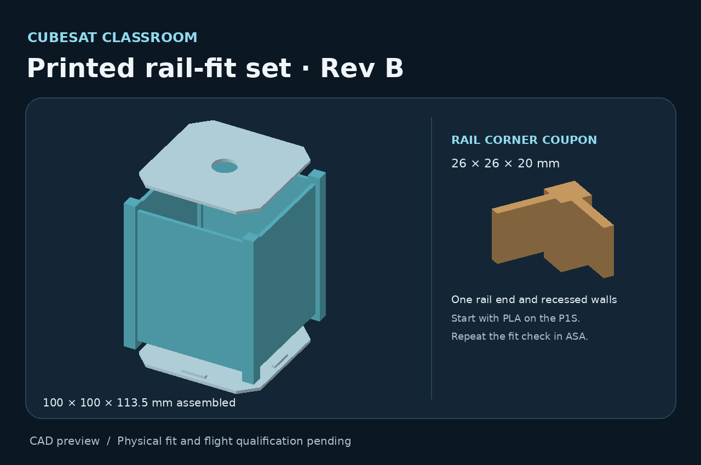

# Archived hardware experiments

These earlier frame experiments are not supported builds. The current design is the [AMSAT CubeSatSim frame with an Arduino payload](amsat-cubesatsim/README.md). The files stay in place because CI regenerates and checks them, and the ISS flight-research quests (M0 to M2) still measure the rail-fit set.

| Experiment | Files |
| --- | --- |
| Rev A bench box and M3 screw-fit coupon (P1S profiles) | [p1s/](p1s/README.md), `stl/bench-shell.stl`, `stl/camera-lid.stl`, `stl/m3-fit-coupon.stl`. Its old quests are in [archive/quest](../archive/quest/README.md). |
| Rev B rail-fit set | `stl/rev-b-*.stl`, [rev-b-drawing.svg](rev-b-drawing.svg), details below |
| Rev C frame (Rust CAD) | [rev-c/](rev-c/README.md), built by `crates/cubesat-cad` |

## Rev B rail-fit set



One printed frame with four continuous 9 mm corner rails, plus two end plates that drop onto slip-fit locators without screws (0.35 mm clearance per side). Nothing holds the plates in yet, so hold them while handling. Positive retainers and payload mounts still need design work. See the [dimensioned drawing](rev-b-drawing.svg).

| Part | Size (mm) | How to print |
| --- | --- | --- |
| [Rail corner coupon](stl/rev-b-rail-corner-coupon.stl) | 26 × 26 × 20 | Print first, rail end down. Check the corner width and the recessed walls. |
| [Rail frame](stl/rev-b-rail-frame.stl) | 100 × 100 × 113.5 | Upright as exported. Turn on build-plate supports: the side walls start 5.4 mm above the bed. Add a brim if the rail feet lift. |
| [Base plate](stl/rev-b-base-plate.stl), [camera plate](stl/rev-b-camera-plate.stl) | 93.3 × 93.3 × 4.4 | Flat face down, locator tabs up. Both should seat without force and stay inside the rails. |

Start with PLA, then repeat the coupon in ASA using the filament maker's profile. Measure the rail width and straightness at both ends and the middle, and note warping and support scars. The [Rev B quests](../quest/README.md#m0--start-now) list what to record. Flight evidence is tracked in the [ISS qualification review](../docs/iss-deployment-review.md#printed-structure-qualification).

## Regenerate the files

The Rev A and Rev B meshes come from [generate.py](generate.py), which also checks that each part is watertight, has the expected size, and that the lids and plates don't collide with their frames. [p1s/prepare.py](p1s/prepare.py) packs the Rev A parts into centered P1S 3MF plates, and [drawing.py](drawing.py) redraws the Rev B drawing.

```sh
python3 -m venv /tmp/cubesat-cad
/tmp/cubesat-cad/bin/pip install -r hardware/requirements.txt
/tmp/cubesat-cad/bin/python hardware/generate.py
/tmp/cubesat-cad/bin/python hardware/p1s/prepare.py
/tmp/cubesat-cad/bin/python hardware/drawing.py
```

The AMSAT kit is built in Rust: `cargo run --release -p amsat-kit` (see [its README](amsat-cubesatsim/README.md#regenerate)). CI runs all of them and fails if the committed files differ from the output.
