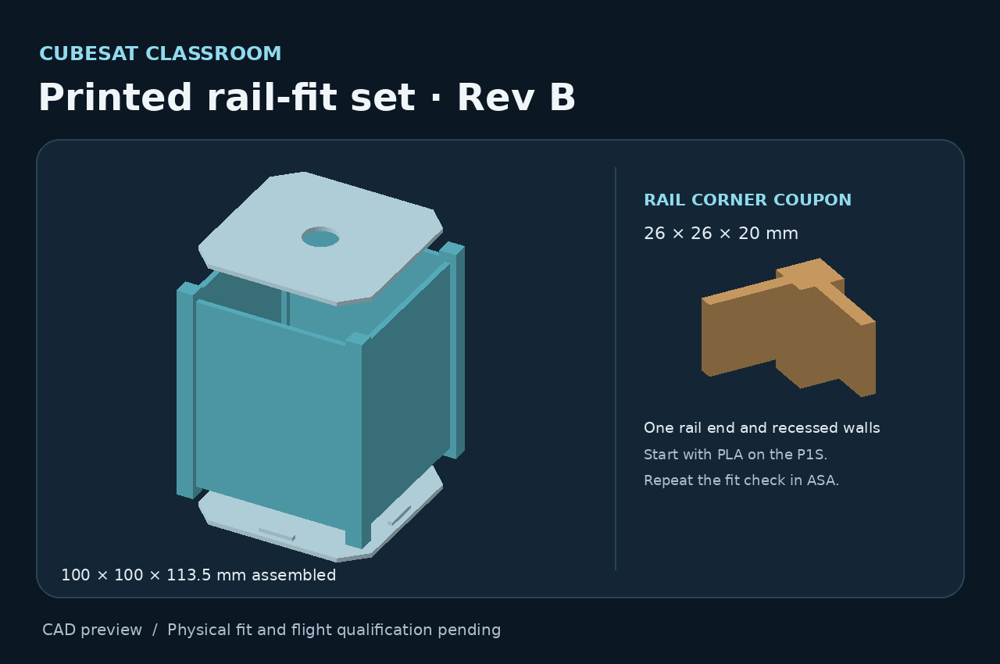
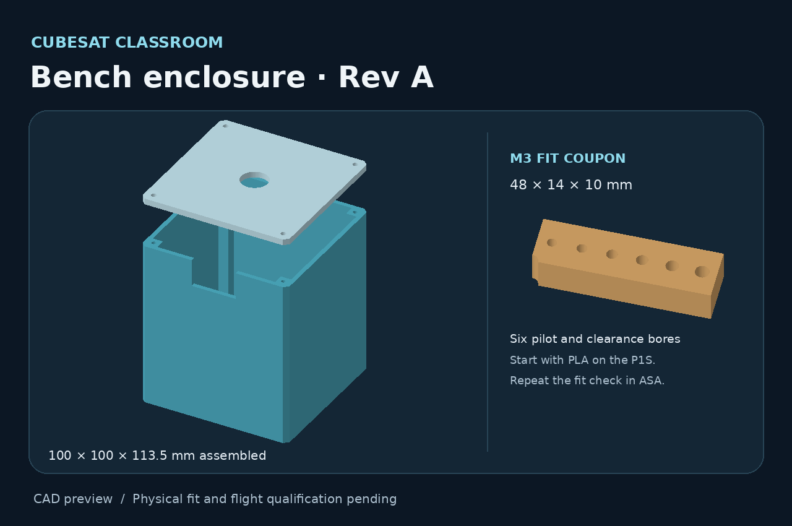

# P1S-printable CubeSat mechanical kit

Every project-designed structural part, cover, mount, retainer and fit tool must have a printable version for a Bambu Lab P1S or equivalent printer. This requirement applies to the mechanical design. Flight electronics, wiring, cells, sensors and RF components are selected separately. The orbital design goal includes the printed rails and load-bearing chassis, subject to the assigned provider accepting the exact material, process and assembled article.

## Rev B rail-fit set

This set uses one printed frame with four continuous corner rails and two printed end plates. The plates seat on slip-fit locators and can be placed without metal screws. Hold them during handling. A positive printed retainer and payload mounts still need design and testing.



| Part | Dimensions (mm) | P1S print and fit check |
| --- | --- | --- |
| [Rail corner coupon](stl/rev-b-rail-corner-coupon.stl) | 26 × 26 × 20 | Print first with the rail end down. Check the corner width and whether the recessed walls print cleanly. |
| [Rail frame](stl/rev-b-rail-frame.stl) | 100 × 100 × 113.5 | Print upright as exported. Enable build-plate supports beneath the recessed side walls, which begin 5.4 mm above the bed. Check support contact and removal in the slicer preview. Add a brim if needed for the four rail feet. |
| [Base plate](stl/rev-b-base-plate.stl) and [camera plate](stl/rev-b-camera-plate.stl) | 93.3 × 93.3 × 4.4 each | Print the large exterior face down with locator tabs up. Check that both plates seat without force and stay within the rail envelope. |

Start with PLA. Repeat the coupon and fit checks in ASA with the filament manufacturer's profile. Record nozzle, layer height, orientation, supports, filament lot and measured dimensions. The CAD has 9 mm square corner rails, 3 mm recessed end plates and 0.35 mm locator clearance per side. These are bench dimensions. Measure rail width, straightness and assembled width at both ends and the middle, then compare the print with the CAD. Record warping and support scars. [Bambu Lab P1S build volume and material support](https://cdn1.bambulab.com/documentation/quick-start-59b0cefdc0fc4/P1S/English%20version-Quick%20Start%20Guide%20for%20P1S.pdf)

The STLs passed mesh and nominal size checks, and both end plates passed the CAD interference check. Bambu Studio slicing, physical prints and deployed fit are pending. See the [ISS qualification review](../docs/iss-deployment-review.md#printed-structure-qualification) for flight evidence.

## Rev A classroom enclosure



The assembled shell measures **100 × 100 × 113.5 mm**. It has a 3 mm wall, 4 mm floor, four corner screw columns, a service slot and a removable lid with an 18 mm camera aperture. The three uninterrupted side faces can be used to try antenna placement and routing with paper or dummy parts. Board holes, deployer rails and actual antenna dimensions depend on hardware and the mission ICD. The current model uses generic packaging dimensions, a 0.35 mm per-side lid-tab gap, 3.5 mm lid clearance holes and 2.8 mm body pilots.

## Print in this order

| File | Size (mm) | Print orientation and fit check |
| --- | --- | --- |
| [m3-fit-coupon.stl](stl/m3-fit-coupon.stl) | 48 × 14 × 10 | Flat on bed. Starting at the notched end, holes are 2.6, 2.8, 3.0, 3.2, 3.5 and 3.8 mm. Test the actual fastener. A clearance hole should pass it freely. A chosen pilot should hold the intended thread without splitting. |
| [camera-lid.stl](stl/camera-lid.stl) | 100 × 100 × 6 | Exterior face down, tabs up. Test camera sightline and fastener head clearance. |
| [bench-shell.stl](stl/bench-shell.stl) | 100 × 100 × 109.5 | Closed floor down, open rim up. Test that the lid seats flat without force and that tool access and cable bend radius work. |

Load each STL at millimetre scale in Bambu Studio and choose the installed nozzle and plate. Use your normal P1S PLA profile for the coupon. Start with supports off and check the layer preview around each bore, the lid tabs and the cable slot. With conventional M3 screws, size the fastener so that its threaded engagement stops above the 10 mm blind pilot floor. Use the CAD parameters for bore sizing and lid clearance after measuring the print.

After the PLA fit, print the coupon again in your ASA with its specific profile. Recheck the gap, bore sizes, flatness, corner lift and visible layer splits before committing to the full shell. Use the enclosure, ventilation and plate guidance for the actual ASA. [Bambu Lab P1S guide](https://cdn1.bambulab.com/documentation/quick-start-2024-01-17/Quick-Start-P1S_en.pdf)

The exported meshes passed size, watertightness, consistent winding and single-solid checks. Slicer preview, print and physical fit are pending. The ASA version is intended for bench packaging and handling trials. A flight application needs provider acceptance of the exact printed design, material and process. [NASA CubeSat 101](https://science.nasa.gov/wp-content/uploads/2023/06/nasa_csli_cubesat_101_508.pdf)

## Regenerate

```bash
python -m venv /tmp/cubesat-cad
/tmp/cubesat-cad/bin/pip install -r hardware/requirements.txt
/tmp/cubesat-cad/bin/python hardware/generate.py
```
