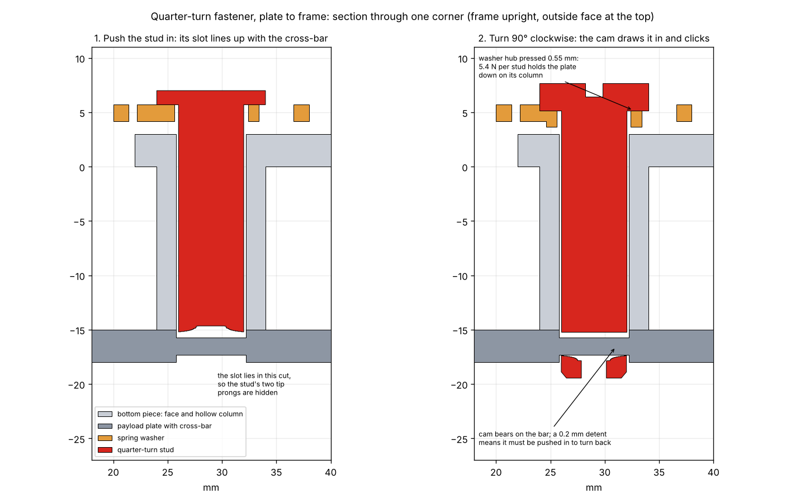

# AMSAT CubeSatSim frame with a printed Arduino payload

A real 1U CubeSat frame (100 × 100 × 113.5 mm) that holds an **Arduino Uno R3** and an **Arduino Nano 33 BLE Sense Rev2** (the bare board, ABX00069). Every part is 3D printed, including the fasteners, their springs and the lock keys: no metal hardware.

The frame is the [AMSAT CubeSat Simulator](https://cubesatsim.org) v2.0 frame, unchanged except for one piece. The payload plate, clamp, fasteners and columns are new parts designed for this kit. They're designed around Arduino's own CAD for both boards (see [reference/](reference/)).

**How the boards are held.** No board relies on a flexing part alone. Real CubeSats hold boards rigidly, because a snap that relies only on its own spring can work loose under launch vibration. The Uno's latches flex to snap in, then a lock key stops each one from opening again.

- **Uno R3:** snaps in with no tools. Short pins in its four holes locate it, and four latches click over its edges at the only places Arduino's layout leaves the edge clear. Each hook's underside is angled 20°, so the arm's spring presses the board down onto its posts (about 7 N per latch) and it can't rattle. Then a red **lock key** drops in behind each latch and clips into place. With the key in, a latch can open only 0.2 mm, so it can't let go, the same idea as the secondary lock on an aerospace connector. If a key won't go in, that corner of the board isn't seated.
- **Nano 33 BLE Sense:** it stands on its long edge like a card in a card cage. V-grooves grip the bottom and top edges along their whole length, and stops at both ends keep it from sliding. The top groove is in a clamp held down by two quarter-turn fasteners, pressing both edges into their V's so the board has no play. The board's own parts face into the CubeSat and never touch the holder.
- **Quarter-turn fasteners:** the plate and the Nano clamp use the push-and-turn panel fastener of aircraft and spacecraft access panels. Push the slotted stud in past a cross-bar, then turn it 90° clockwise with a flat screwdriver. A spiral cam slot in the stud draws it in against a printed spring washer, then drops the bar into a detent you can feel click. To undo it you have to push in and turn back, so vibration can't turn it loose.
  - The plate's four studs go in from **outside the bottom face**, up through hollow columns, the way real spacecraft panels are fastened from outside.
  - Each spring washer is printed flat with two long spiral arms, so the arms bend along their layers, the strong direction for a printed part.
  - Together the four plate studs hold the plate down with about 21 N, more than the payload weighs at 20 g, a common design load for small-satellite launch. Above that, the washers squeeze and the plate can lift a fraction of a millimetre, but nothing can come apart: the bar and cam are solid stops.
  - The basic design is decades old and is described here without brand names. This isn't legal advice: check with someone qualified before selling copies.




## Credit and license

- **Frame:** AMSAT CubeSatSim v2.0 by Alan Johnston, KU2Y, AMSAT VP Educational Relations. Source: [alanbjohnston/CubeSatSim `hardware/frame/v2.0`](https://github.com/alanbjohnston/CubeSatSim/tree/master/hardware/frame/v2.0), commit `1f6a01c4` (2024-10-07), with the [Onshape CAD](https://cad.onshape.com/documents/ba47819ff100597297d1d967/w/f19409ec7cd5459afb429cb9/e/a0e0cc37dee6fb879c4bcc2b) linked from there.
- **License:** the CubeSatSim repository is GPL-3.0, so everything in this folder is GPL-3.0 too ([LICENSE](LICENSE)). The rest of CubeSat Classroom keeps its MIT or Apache-2.0 terms.
- **Changes:** modified by CubeSat Classroom on 2026-11-25. `bottom-with-columns` is the AMSAT top/bottom piece with four hollow standoff columns added where the AMSAT board stack normally screws in. The plate's quarter-turn studs pass through the columns and the 3.2 mm stack holes, which are opened to 6.4 mm. The payload plate, clamp, fasteners, keys and load test are new parts. The files in [upstream/](upstream/) are AMSAT's, byte for byte (SHA-256 below).
- This is an independent build. It isn't made or endorsed by AMSAT.

## What to print

Everything is in one Bambu Studio project, **[p1s/cubesat-kit.3mf](p1s/cubesat-kit.3mf)**. Open it in Bambu Studio (File → Open Project). It has three plates, each with a name and a preview picture, and every part already in its print orientation. It fits any Bambu Lab printer with a 256 mm bed (P1S, P1P, X1 Carbon, X1E, A1).

| Plate | What's on it |
| --- | --- |
| 1. Payload deck and fasteners | Payload plate with the Uno latches, the Nano clamp, the load test (post and tab), 4 lock keys, 4 plate studs, 2 clamp studs and 6 spring washers |
| 2. Frame | Both AMSAT sides (one with the camera hole), the AMSAT top (unchanged) and the bottom with hollow columns |
| 3. Display plate (optional) | The isogrid display plate with its own Nano clamp and a full set of keys, studs and washers, so it builds into a second, display-ready payload |

Before you slice:

- **Printer and process:** the project keeps whatever printer, process and filament you have selected. Pick your printer and nozzle (for example *Bambu Lab P1S 0.6 nozzle*), the matching *0.30mm Standard* process (or *0.20mm Standard* for a 0.4 mm nozzle), and PLA. Supports stay off.
- **Already set in the file:** the keys, studs, washers and load-test parts print at 100% infill, since they're small and carry the load. Each part is its own object with a numbered name (Lock key 1 to 8, Plate stud 1 to 8 and so on), so Bambu Studio keeps every part on the plate it was placed on.
- **Colours with an AMS:** select the four lock keys and give them red filament, like flight safety pins. On plate 3, set a filament change at 2.4 mm to white and back at 3.0 mm, so only the raised lettering is white.
- **Plate 1 first:** run the load test (below) before you assemble anything. If the fasteners need a tweak, regenerate and reprint just those parts; Bambu Studio can skip objects on a plate.

None of the plates has been sliced for a time estimate yet. For other slicers, every part is in [stl/](stl/) as a separate file, already in print orientation.

**Print the load test first, and do a real pull test.** It's one plate fastener on its own: the post is the bottom face and a column, and the tab is a corner of the plate.

1. Push the stud, with its washer feet down, through the post from the flat end. Then put the tab on, flat side to the post, and push it over the stud's tip so the bar slips into the slot. Turn the stud 90° clockwise with a flat screwdriver until it clicks.
2. The stud should turn with a firm, even effort and click at the end. If it won't turn, the bar is too tight in the slot: raise `QT_CLEAR` in [generate.py](generate.py) from 0.3 to 0.4. If it turns with no effort and doesn't click, lower it to 0.2. Then regenerate.
3. Hang the post by its hole and hang weights from the tab's hole, pulling the tab straight off the stud. With about 0.6 kg on it, the washer starts to squeeze and the tab lifts slightly. That's the preload, and it's expected. Keep adding weight up to 2 kg: it should hold without coming apart. That's the whole payload's weight at 20 g on one fastener, four times its share. By hand calculation the bar would start to yield at around 5 kg; if you test further, do it over something soft.
4. Shake it hard with a weight on it and check the stud hasn't turned. Write down what it held, and report it with the [P1S case quests](../../quest/README.md#bambu-p1s-case-test-track).

**The display plate (plate 3)** has the payload plate's latches, pillars, Nano card cage and quarter-turn receptacles, made by the same code and in the same places, so a fit you check on one holds for the other. It mounts on the bottom piece the same way too. Check that the Uno clicks in and every key clips in, that the Nano goes in, and that all the studs turn and click.

It's made as a display piece for photos and school projects. It's a 2.4 mm isogrid panel, the triangular rib pattern used on rocket and satellite structures, with a bevelled rim. It has a raised CUBESAT CLASSROOM nameplate under the Uno and a +X/+Y axis marker like a spacecraft body frame. The lettering, nameplate border and arrows stand 0.6 mm proud, so two colours are easy:

- In Bambu Studio, add a filament change at **2.4 mm** (white) and another at **3.0 mm** (back to the panel colour), so only the lettering is white.
- With an AMS, Studio does both changes automatically. Without one, the printer pauses for each swap.
- Dark grey or black for the panel, with white lettering, looks most like flight hardware.

To change the wording, edit `LINES` in [label.py](label.py), run it (it needs `matplotlib` for its bundled DejaVu Sans Bold font), then regenerate. The CAD reads the outlines from `label.json`, so `generate.py` itself doesn't need matplotlib.

## Assemble

1. **Uno R3:** line its holes up with the four pins, USB-B towards the plate edge on the left, and press straight down near each corner until all four latches click. Then push a lock key into the slot behind each latch, ring hole up, until it clicks. A key that won't go in means that corner isn't seated: press the board down there and try again.
2. **Nano 33 BLE Sense** (bare board, parts facing the Uno, USB to the left): lower it into the V-groove on the plate so its USB end sits against the small corner stop and its other end against the end wall.
3. **Lower clamp:** set it on so its groove takes the Nano's top edge. Put a washer (feet down) and a short stud in each of its two holes, push down and turn each stud 90° clockwise until it clicks. The Nano should now be held tight with no play. The clamp doesn't touch the Uno, so either board comes out on its own.
4. **Plate into the frame:** turn the plate over and set it on the four columns of the bottom piece. From outside the bottom face, push a long stud with its washer into each column, then turn each one 90° clockwise until it clicks. Do the plate before the Uno if you can: the stud under the Uno's USB corner is easier to reach.
5. **Frame:** snap the two sides onto the bottom, then the top, the same way as AMSAT's frame. AMSAT notes the frame holds together on its own. Skip their optional screws to keep it 100% printed.

To take the Uno out, pull the four keys (a loop of ribbon through each key's hole helps), push each latch outward a little and lift the board. To take the Nano out, push in and turn its clamp's two studs back a quarter turn. To take the plate out, do the same with the four studs on the bottom face.

The Nano's USB plug needs about 28 mm to the left of the board, and it ends about 1 mm inside the plate edge. Use a right-angle Micro-USB cable if a side panel is in the way. The Nano's sensors face the Uno, 15 mm away, so the light sensor sees the inside of the CubeSat. Take the side panel off for light lessons.

## How it fits

| Check | Value |
| --- | --- |
| Plate | 88 × 88 × 3 mm with 8 mm corner chamfers (AMSAT's boards are 90.5 mm) |
| Plate position | 15 mm inside the bottom face, below AMSAT's 12 mm snap tabs |
| Uno R3 | On 10 mm posts with 2.9 mm locating pins. Four latches 8 mm wide. The 1.8 mm arms are 13.1 mm long, rooted in 1.5 mm pockets in the plate. The hook reaches 0.8 mm, which bends the arm 1.3% snapping in, under a 1.5% limit because the arms print upright and bend across their layers. The hook underside is at 20° with 0.15 mm preload, about 7 N down per latch. Lock keys are 1.8 mm thick with 0.1 mm clearance each side, so a latch opens at most 0.2 mm and keeps 0.45 mm of grip. The keys clip in with two 0.35 mm detents (1.5% prong strain). |
| Nano 33 BLE Sense Rev2 | 43.18 × 17.78 × 1.59 mm (from Arduino's CAD), on edge in V-grooves 2.4 mm wide at the mouth, 1.4 mm at the bottom and 2.0 mm deep. Each edge sits 1.62 mm in. 0.5 mm end play between the stops (the first fit print at 0.2 mm was a little tight). |
| Quarter-turn studs | 6.0 mm shank in 6.4 mm holes, 10 mm slotted head. The cross-bar is 2.0 × 1.6 mm. The cam draws the stud in 0.55 mm over the first 75°, then a 0.2 mm detent. At least 1.6 mm of stud stays behind the bar. Plate studs are 27 mm long, clamp studs 13 mm. |
| Spring washers | 18 mm, printed flat. Two 1.6 × 1.5 mm spiral arms, each about 16 mm long, on three 1.2 mm feet. 1.6% strain at the detent crest, under 2%. About 5.4 N per plate stud and 6.8 N per clamp stud. |
| Plate hold-down | 4 × 5.4 = 21 N, against 20 N for 100 g of payload at 20 g. The receptacle bar sees about 8 MPa. |
| Nano clamp | The Nano's edge lifts the clamp 0.15 mm off its pillars, so both washers press the board into its V-grooves: about 14 N. |

[generate.py](generate.py) assembles the parts in frame coordinates and fails if:

- the plate holes don't line up with the columns, or the plate hits the AMSAT piece or its snap tabs
- a stud can't be pushed in past its bar, collides with anything when locked, or isn't held by its bar; or a plate stud's washer would sit on a raised part of the face
- the washer arms would bend more than 2%, its feet are too short for the hub to travel, the four plate studs hold less than the payload weighs at 20 g, a stud has no detent or too little material behind the bar, or the bar is overstressed
- any part sits where a plate stud's tip comes through, or reaches past the plate outline into the frame's corner rails
- a latch, key or pillar hits any Uno part listed in Arduino's layout (headers, jacks, ICSP, the ATmega socket, capacitors, crystal, reset button, …), or something sits under its solder joints. These checks use the latches bent to their seated position.
- a latch's hook doesn't reach over the board, the board can't be pushed down past the latches bent open, or a latch arm would bend more than 1.5%
- a lock key doesn't fit its latch, a latch could open past its key, or a key leaves a latch more than half its grip to open
- the key prongs would bend more than 2%, or their slot is too narrow for the detents
- a groove wall, stop or clamp touches a part on the Nano, or the V-groove walls reach its parts
- the Nano could move 0.3 mm in any direction (up, down, either side, or along it past its end play), or either groove alone fails to hold it sideways
- the Nano can't be lowered into its groove with the clamp off, or the Uno onto its posts
- anything blocks the Nano's USB plug, or there's less than 20 mm from its USB to the plate edge
- a peg would bend more than PLA can take over and over

`python generate.py --self-test` breaks the design fourteen ways and checks that each one is caught, and that a design exactly at a limit still passes.

Not yet checked on a real print: the quarter-turn fasteners (do the load test), the Uno latches and keys, and the Nano's grip. The spring and strain figures are hand calculations for PLA, not test results. Report what you find with the [P1S case quests](../../quest/README.md#bambu-p1s-case-test-track).

## Regenerate

```sh
python3 -m venv /tmp/cubesat-cad
/tmp/cubesat-cad/bin/pip install -r hardware/requirements.txt
/tmp/cubesat-cad/bin/python hardware/amsat-cubesatsim/generate.py
/tmp/cubesat-cad/bin/python hardware/amsat-cubesatsim/prepare.py
```

To redraw the layout image and the two sections, install `matplotlib` too and run `python layout.py`, `python latch_section.py` and `python qt_section.py` from this folder.

To rebuild the reference board models in [reference/](reference/), follow [reference/README.md](reference/README.md).

Upstream checksums (SHA-256):

```
34c9737cd7a26b5df9b34df2227ffc6aecfdbc02061d5a5a1234c1b2ddb30784  upstream/cubesatsim_frame_side.v2.0.stl
df1d094d1110f4a5d77c2b580937f8cb6df850ceacb43847701be3b9036afa04  upstream/cubesatsim_frame_side_camera.v2.0.stl
8f6ffc3367aca32192878f5a98caab0e6d6c74b85a1ea21323669c52d9d81d21  upstream/cubesatsim_frame_top_bottom.v2.0.stl
```
