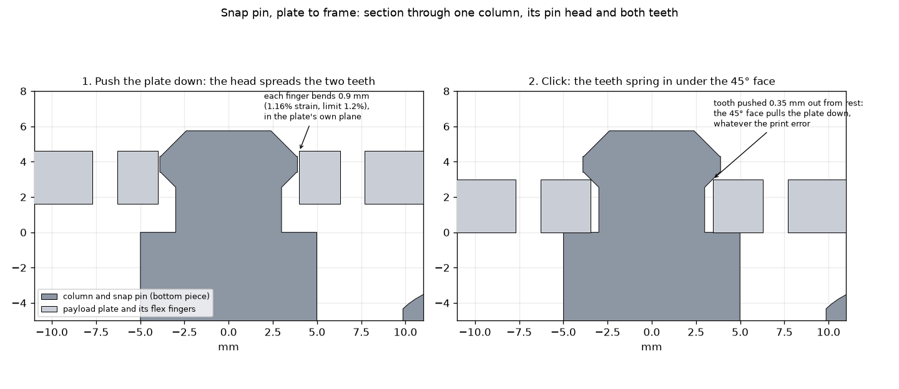
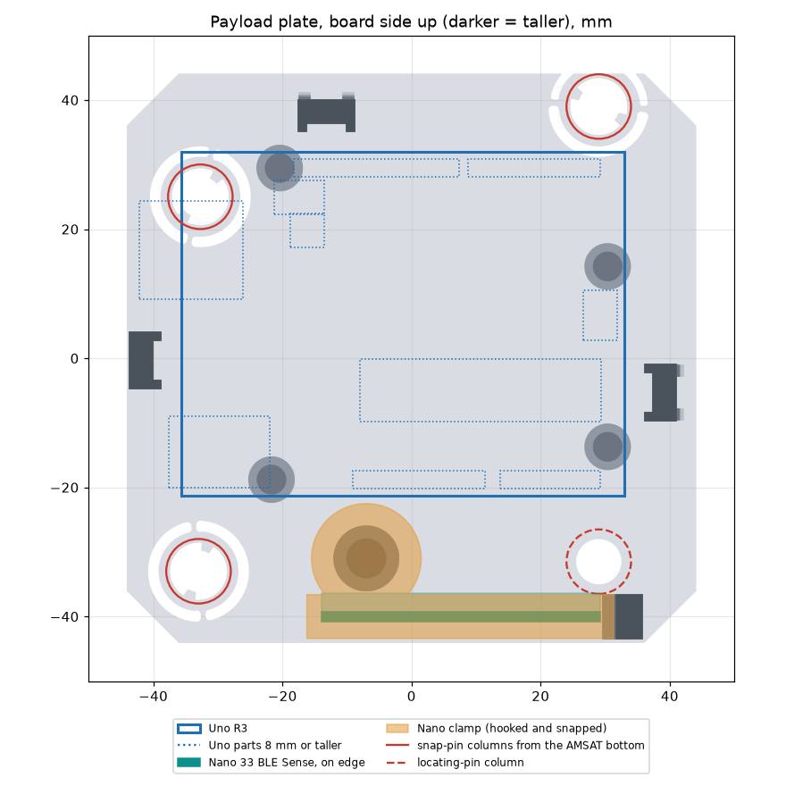

# AMSAT CubeSatSim frame with a printed Arduino payload

A real 1U CubeSat frame (100 × 100 × 113.5 mm) that holds an **Arduino Uno R3** and an **Arduino Nano 33 BLE Sense Rev2** (the bare board, ABX00069). Every part is 3D printed, including every fastener and lock: no screws, springs or metal hardware, and no tools.

The frame is the [AMSAT CubeSat Simulator](https://cubesatsim.org) v2.0 frame, unchanged except for one piece. The payload plate, clamp, clips, keys and columns are new parts designed for this kit, around Arduino's own CAD for both boards (see [reference/](reference/)).

## How it holds together: snap, then lock

Everything snaps together, and is designed to the rules for printed snap fits, so it works on a worn or budget printer, not just a tuned one:

- **Every part that flexes bends in its own print plane**, along its printed strands, never across its layers. Printed hooks that grow up off the bed are the weak way round, so the Uno's latches are separate clips printed lying flat.
- **Strain is at most 1.2%**, about 15% of PLA's 8% elongation at break, so a snap can be used over and over without cracking or taking a set.
- **Nothing that flexes or carries load is thinner than 2 mm**, and the clearances are 0.4 mm.
- **Every snap closes on a 45° face.** It prints without supports, and it pulls its joint tight whatever the print error, so nothing rattles.
- **The Uno latches have a secondary lock:** a red key that stops each clip from opening, like the position-assurance clip on an aerospace connector. If a key won't go in, that corner of the board isn't seated.

Every part has one big flat face, the face it prints on, so Bambu Studio's auto-orient puts it down the right way.

**Plate to frame: snap pins.** Three of the bottom piece's columns end in a pin with a 45° head; the fourth, next to the Nano, has a plain locating pin. Around each snap pin, the plate has two curved flex fingers with a tooth at their tips. Press the plate straight down: the heads spread the teeth, then they click in under the heads. Each tooth sits 0.35 mm out from rest on the 45° face, so the plate is pulled down onto the columns, and print error within about 0.2 mm only changes how hard. It takes about 30 N to pull the plate off, more than the payload weighs at 20 g (a common design load for small-satellite launch). To take it off, pull firmly and evenly.

**Uno R3: latch clips with lock keys.** Short pins in its four holes locate it on 16 mm posts. Three clips hold its left, right and top edges, at the only places Arduino's layout leaves clear of parts, posts and the frame's columns. Each clip's foot slides into a tunnel in its backstop, and its arm stands beside the board edge with a hook over it. The hook's underside is angled 20°, so the arm's spring presses the board down onto its posts (about 5 N per clip). With the key in behind the arm, a clip can open only 0.2 mm, and its hook keeps 0.35 mm on the board.

**Nano 33 BLE Sense: card cage, hook and snap.** It stands on its long edge like a card in a card cage. V-grooves grip its bottom and top edges along their whole length, and stops at both ends keep it from sliding. The top groove is in the clamp: its far end tucks under a lip with a 45° underside, and its near end snaps onto a pin on a pillar. The board's own parts face into the CubeSat and never touch the holder.






## Credit and license

- **Frame:** AMSAT CubeSatSim v2.0 by Alan Johnston, KU2Y, AMSAT VP Educational Relations. Source: [alanbjohnston/CubeSatSim `hardware/frame/v2.0`](https://github.com/alanbjohnston/CubeSatSim/tree/master/hardware/frame/v2.0), commit `1f6a01c4` (2024-10-07), with the [Onshape CAD](https://cad.onshape.com/documents/ba47819ff100597297d1d967/w/f19409ec7cd5459afb429cb9/e/a0e0cc37dee6fb879c4bcc2b) linked from there.
- **License:** the CubeSatSim repository is GPL-3.0, so everything in this folder is GPL-3.0 too ([LICENSE](LICENSE)). The rest of CubeSat Classroom keeps its MIT or Apache-2.0 terms.
- **Changes:** modified by CubeSat Classroom on 2026-11-25. `bottom-with-columns` is the AMSAT top/bottom piece with four standoff columns added where the AMSAT board stack normally screws in; three end in snap pins and one in a locating pin. The payload plate, clamp, latch clips, keys, fit plate and test coupons are new parts. The files in [upstream/](upstream/) are AMSAT's, byte for byte (SHA-256 below).
- This is an independent build. It isn't made or endorsed by AMSAT.

## What to print

There are three Bambu Studio projects. Open any of them in Bambu Studio (File → Open Project). Each plate has a name and a preview picture, and every part is already in its print orientation. They fit any Bambu Lab printer with a 256 mm bed (P1S, P1P, X1 Carbon, X1E, A1).

| File | Plate | What's on it |
| --- | --- | --- |
| **[p1s/cubesat-test-coupons.3mf](p1s/cubesat-test-coupons.3mf)** (print first) | Test coupons | One snap pin and its flex fingers, and one Uno latch with its clip, key and a strip of test board: about 4 g and 5 g |
| **[p1s/cubesat-kit.3mf](p1s/cubesat-kit.3mf)** | 1. Payload deck, clamp and latches | Payload plate, Nano clamp, 3 latch clips and 3 lock keys |
| | 2. Frame | Both AMSAT sides (one with the camera hole), the AMSAT top (unchanged) and the bottom with columns |
| **[p1s/cubesat-fit-plate.3mf](p1s/cubesat-fit-plate.3mf)** (optional) | Fit plate, clamp and latches | The open-truss fit plate with its own clamp, clips and keys |

Before you slice:

- **Printer and process:** the projects keep whatever printer, process and filament you have selected. Pick your printer and nozzle (for example *Bambu Lab P1S 0.6 nozzle*), the matching *0.30mm Standard* process (or *0.20mm Standard* for a 0.4 mm nozzle), and PLA. Supports stay off. Auto-orient is fine: each part already lies on its biggest flat face.
- **Already set in the files:** the clips, keys and pin coupon print at 100% infill, since they flex. Each part is its own object with a numbered name (Latch clip 1 to 3, Lock key 1 to 3 and so on), so Bambu Studio keeps every part on the plate it was placed on.
- **Colours with an AMS:** give the lock keys red filament, like flight safety pins. The CubeSat Classroom mark and lettering under the Uno stand 0.6 mm proud: add a filament change at **3.0 mm** (white) and another at **3.6 mm** (back to the plate colour), so only they are white.

None of the plates has been sliced for a time estimate yet. For other slicers, every part is in [stl/](stl/) as a separate file, already in print orientation.

**Print the test coupons first.** They're the two joints on their own, so a class can check a printer with a few grams of plastic instead of a whole plate:

1. **Snap pin:** press the tab (flat side down) onto the pin until it clicks. It should take a firm push and stay tight with no rattle. Pull it off: it should take a firm, even pull. If it won't go on, the fingers are too stiff for that printer: print the tab again with one less wall.
2. **Latch:** slide the clip's foot into the tunnel in the backstop, hook towards the posts. Press the board strip down onto the two posts until the hook clicks over its edge, then push the key in behind the clip until it clicks. The board strip should be held with no play, and the clip shouldn't open with the key in.

Write down what you find and report it with the [P1S case quests](../../quest/README.md#bambu-p1s-case-test-track).

**The fit plate** has the payload plate's posts, latches, card cage, clamp mounts, snap holes and branding, made by the same code and in the same places, on an open triangular truss instead of a solid deck: about 26 g instead of 37 g, solid. A fit you check on it holds for the real plate, and it snaps onto the bottom piece the same way. It also makes a display piece for photos and school projects: dark grey or black with white lettering looks most like flight hardware.

To change the wording, edit `LINES` in [label.py](label.py), run it (it needs `matplotlib` for its bundled DejaVu Sans Bold font), then regenerate. The CAD reads the outlines from `label.json`, and the mark is drawn from the shapes in [docs/mark.svg](../../docs/mark.svg).

## Assemble

1. **Plate onto the frame:** set the plate, board side up, over the bottom piece's four columns, the locating pin by the Nano's corner, and press straight down over each column until all three snap pins click.
2. **Uno R3 clips:** slide each clip's foot into the tunnel under its backstop, hook towards the board.
3. **Uno R3:** line its holes up with the four pins, USB-B towards the plate edge on the left, and press straight down near each corner until all three clips click. Then push a lock key into the slot behind each clip, ring hole up, until it clicks. A key that won't go in means that corner isn't seated: press the board down there and try again.
4. **Nano 33 BLE Sense** (bare board, parts facing the Uno, USB to the left): lower it into the V-groove on the plate so its USB end sits against the small corner stop and its other end against the end wall.
5. **Nano clamp:** tuck its far end under the lip past the Nano's far end, lay its groove onto the Nano's top edge, and press its round end down onto the pin until it clicks. The Nano should now be held tight with no play. The clamp doesn't touch the Uno, so either board comes out on its own.
6. **Frame:** snap the two sides onto the bottom, then the top, the same way as AMSAT's frame. AMSAT notes the frame holds together on its own. Skip their optional screws to keep it 100% printed.

To take the Uno out, pull the three keys (a loop of ribbon through each key's hole helps), push each clip outward a little and lift the board. To take the Nano out, lift the clamp's round end off its pin and slide its far end out from under the lip. To take the plate out, pull it straight off the columns.

The Nano's USB plug needs about 28 mm to the left of the board, and it ends about 1 mm inside the plate edge. Use a right-angle Micro-USB cable if a side panel is in the way. The Nano's sensors face the Uno, 15 mm away, so the light sensor sees the inside of the CubeSat. Take the side panel off for light lessons.

## How it fits

| Check | Value |
| --- | --- |
| Plate | 88 × 88 × 3 mm with 8 mm corner chamfers (AMSAT's boards are 90.5 mm) |
| Plate position | 15 mm inside the bottom face, below AMSAT's 12 mm snap tabs |
| Snap pins | 6 mm shaft, 7.8 mm head with a 45° underside. Each finger is 2 mm wide and about 15 mm long; it bends 0.9 mm in the plate's plane to let a head pass (1.16% strain, limit 1.2%). The teeth sit 0.35 mm out from rest on the head's 45° face. About 9.9 N to pull the plate off each pin, 30 N for three, against 20 N for 100 g of payload at 20 g. |
| Uno R3 | On 16 mm posts with 2.9 mm locating pins. Clips are 6 mm wide, printed lying flat. Their 2 mm arms are 15.2 mm long from the foot; the hook reaches 0.7 mm, bending the arm 0.93% in its print plane snapping in. The hook underside is at 20° with 0.15 mm preload, about 5 N down per clip. Lock keys are 1.8 mm thick with 0.1 mm clearance each side, so a clip opens at most 0.2 mm and keeps 0.35 mm of grip. The keys clip in with two 0.3 mm detents (0.86% prong strain). |
| Nano 33 BLE Sense Rev2 | 43.18 × 17.78 × 1.59 mm (from Arduino's CAD), on edge in V-grooves 2.4 mm wide at the mouth, 1.4 mm at the bottom and 2.0 mm deep. Each edge sits 1.62 mm in. 0.5 mm end play between the stops (the first fit print at 0.2 mm was a little tight). |
| Nano clamp | 4 mm thick. The Nano's edge lifts it 0.15 mm, so its far end presses up into the lip's 45° face and its near end is held by the snap pin: the board is pressed into both V-grooves. |

[generate.py](generate.py) assembles the parts and fails if:

- a snap pin's fingers, a latch arm or a key prong would bend more than 1.2%, or anything that flexes or carries load is thinner than 2 mm
- the teeth would meet a pin head less than 0.2 mm out from rest (so print error could leave it loose), or too near the head's edge to hold, or the three snap pins hold less than 1.5 times the payload's weight at 20 g
- the plate hits the columns or the AMSAT piece or its snap tabs, can't be pushed down past the pin heads with its fingers spread, isn't pressed down by the teeth, or isn't held when pulled
- any part stands on a set of flex fingers, sits where a pin head comes through, or reaches past the plate outline into the frame's corner rails
- the clamp hits the plate's parts, can't be pressed onto its pin, isn't pressed down or held by its pin and the lip, or its tab could lift out from under the lip
- a clip doesn't fit its backstop and tunnel, its foot isn't held down, its hook doesn't reach over the board, or the board can't be pushed down past the clips bent open
- a clip, key, clamp or pillar hits any Uno part listed in Arduino's layout (headers, jacks, ICSP, the ATmega socket, capacitors, crystal, reset button, …), or something sits under its solder joints. These checks use the clips bent to their seated position.
- a lock key doesn't fit behind its clip, a clip could open past its key, or a key leaves a clip more than half its grip to open
- a groove wall, stop or clamp touches a part on the Nano, the V-groove walls reach its parts, the Nano could move 0.3 mm in any direction, or either groove alone fails to hold it sideways
- the Nano can't be lowered into its groove with the clamp off, anything blocks its USB plug, or there's less than 20 mm from its USB to the plate edge
- the snap-pin coupon doesn't fit together the same way

`python generate.py --self-test` breaks the design seventeen ways and checks that each one is caught, and that flex fingers exactly at the strain limit still pass.

Not yet checked on a real print: nothing in this version has been printed. The strain and force figures are hand calculations for PLA (a straight-beam estimate for the curved fingers), not test results. Print the coupons first and report what you find with the [P1S case quests](../../quest/README.md#bambu-p1s-case-test-track).

## Regenerate

```sh
python3 -m venv /tmp/cubesat-cad
/tmp/cubesat-cad/bin/pip install -r hardware/requirements.txt
/tmp/cubesat-cad/bin/python hardware/amsat-cubesatsim/generate.py
/tmp/cubesat-cad/bin/python hardware/amsat-cubesatsim/prepare.py
```

To redraw the layout image and the two sections, install `matplotlib`, `scipy`, `shapely` and `networkx` too and run `python layout.py`, `python latch_section.py` and `python snap_section.py` from this folder.

To rebuild the reference board models in [reference/](reference/), follow [reference/README.md](reference/README.md).

The website renders (`render-exploded.png`, `render-exploded-dark.png`, `render-exploded-navy.png` and `render-assembled.png`) still show an earlier version of the payload. `render.py` hasn't been updated since the strap-mounted Nano and won't run as it is.

Upstream checksums (SHA-256):

```
34c9737cd7a26b5df9b34df2227ffc6aecfdbc02061d5a5a1234c1b2ddb30784  upstream/cubesatsim_frame_side.v2.0.stl
df1d094d1110f4a5d77c2b580937f8cb6df850ceacb43847701be3b9036afa04  upstream/cubesatsim_frame_side_camera.v2.0.stl
8f6ffc3367aca32192878f5a98caab0e6d6c74b85a1ea21323669c52d9d81d21  upstream/cubesatsim_frame_top_bottom.v2.0.stl
```
