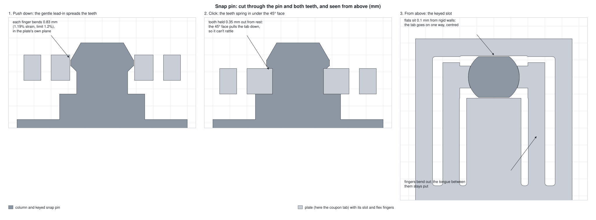
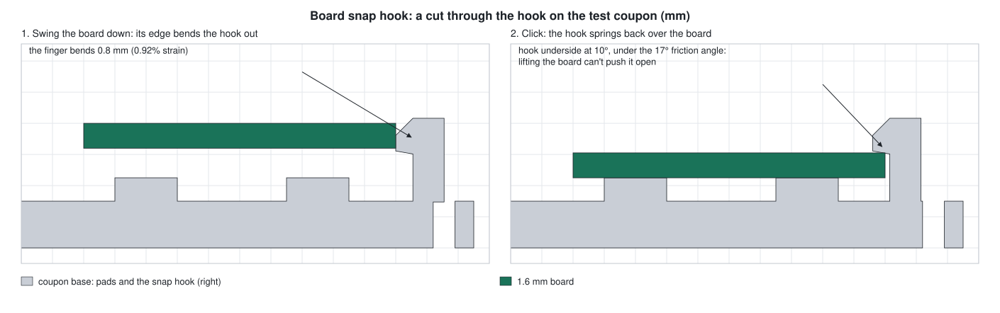

# AMSAT CubeSatSim frame with a printed Arduino payload

A real 1U CubeSat frame (100 × 100 × 113.5 mm) that holds an **Arduino Uno R3** and an **Arduino Nano 33 BLE Sense Rev2** (the bare board, ABX00069). Every part is 3D printed, with no screws, springs, metal hardware or tools.

**There are no loose parts.** The whole kit is AMSAT's four frame pieces plus one payload plate. Every snap, hook and lip is part of the plate or the frame, so there is nothing small to drop, lose or throw away by mistake.

The frame is the [AMSAT CubeSat Simulator](https://cubesatsim.org) v2.0 frame, unchanged except for one piece. The payload plate and its joints are new, designed around Arduino's own CAD for both boards (see [reference/](reference/)).

## How it holds together

Every joint follows the usual rules for printed snap fits, so it works on a worn or budget printer, not just a tuned one:

- **Every part that flexes bends in the plate's own plane**, along its printed strands, never across its layers.
- **Strain is at most 1.2%**, about 15% of PLA's 8% elongation at break, so a snap can be used over and over without cracking or taking a set.
- **Nothing that flexes or carries load is thinner than 2 mm**, and clearances are 0.4 mm.
- **Every snap closes on an angled face that prints without supports.** It pulls the joint tight whatever the print error, so nothing rattles.
- **Every part has one big flat face** to print on, so Bambu Studio's auto-orient puts it down the right way.

**Plate to frame: snap pins.** Three of the bottom piece's columns end in a pin with a 45° head. The fourth, next to the Nano, has a plain locating pin. Around each snap pin the plate has two curved flex fingers with a tooth at their tips. Press the plate straight down: the heads spread the teeth, then the teeth click in under the heads. Each tooth sits 0.35 mm out from rest on the 45° face, so the plate is pulled down onto the columns. It takes about 30 N to pull the plate off, against 16 N for an 80 g payload at 20 g (a common design load for small-satellite launch).

**Both boards: tuck and click.** Each board has fixed lips on one edge and snap hooks on the other. Tuck the lip edge under its lips, then swing the board down: its far edge pushes the hooks out sideways, and they spring back over it. Each hook is a post on an 18 mm finger cut into the plate, so it bends in the plate's plane. The hook's underside is angled 10°, less than the 17° friction angle of PLA on a circuit board, so lifting the board can't push a hook open. To take a board out, push its hooks outward with a fingertip and lift.

- **Uno R3:** stands on four 5.5 mm posts, with short pins in its holes. One lip holds its left edge (between the DC jack and the USB-B socket), and hooks hold its right and top edges, at places Arduino's layout leaves clear.
- **Nano 33 BLE Sense:** lies flat on 1.5 mm pads, parts up. Two lips hold one long edge and two hooks the other. Corner stops keep it from sliding, and leave its USB socket clear.






## Credit and license

- **Frame:** AMSAT CubeSatSim v2.0 by Alan Johnston, KU2Y, AMSAT VP Educational Relations. Source: [alanbjohnston/CubeSatSim `hardware/frame/v2.0`](https://github.com/alanbjohnston/CubeSatSim/tree/master/hardware/frame/v2.0), commit `1f6a01c4` (2024-10-07), with the [Onshape CAD](https://cad.onshape.com/documents/ba47819ff100597297d1d967/w/f19409ec7cd5459afb429cb9/e/a0e0cc37dee6fb879c4bcc2b) linked from there.
- **License:** the CubeSatSim repository is GPL-3.0, so everything in this folder is GPL-3.0 too ([LICENSE](LICENSE)). The rest of CubeSat Classroom keeps its MIT or Apache-2.0 terms.
- **Changes:** modified by CubeSat Classroom on 2026-11-25. `bottom-with-columns` is the AMSAT top/bottom piece with four standoff columns added where the AMSAT board stack normally screws in; three end in snap pins and one in a locating pin. The payload plate, fit plate and test coupons are new parts. The files in [upstream/](upstream/) are AMSAT's, byte for byte (SHA-256 below).
- This is an independent build. It isn't made or endorsed by AMSAT.

## What to print

There are three Bambu Studio projects. Open any of them in Bambu Studio (File → Open Project). Each plate has a name and a preview picture, and every part is already in its print orientation. They fit any Bambu Lab printer with a 256 mm bed (P1S, P1P, X1 Carbon, X1E, A1).

| File | Plate | What's on it |
| --- | --- | --- |
| **[p1s/cubesat-test-coupons.3mf](p1s/cubesat-test-coupons.3mf)** (print first) | Test coupons | A snap pin with its flex-finger tab, and a board hook and lip with a strip of test board: about 4 g and 3 g |
| **[p1s/cubesat-kit.3mf](p1s/cubesat-kit.3mf)** | 1. Payload plate and bottom | The payload plate and the bottom piece with columns |
| | 2. Sides and top | Both AMSAT sides (one with the camera hole) and the AMSAT top (unchanged) |
| **[p1s/cubesat-fit-plate.3mf](p1s/cubesat-fit-plate.3mf)** (optional) | Fit plate | The open-truss fit plate |

Before you slice:

- **Printer and process:** the projects keep whatever printer, process and filament you have selected. Pick your printer and nozzle (for example *Bambu Lab P1S 0.4 nozzle*), the matching *0.20mm Standard* process, and PLA. Supports stay off. Auto-orient is fine.
- **Already set in the files:** the coupon bases and the pin tab print at 100% infill, since they flex. Each part is its own object, so Bambu Studio keeps every part on the plate it was placed on.
- **Colours with an AMS:** the CubeSat Classroom mark and lettering stand 0.6 mm proud of the plate. Add a filament change at **3.0 mm** (white) and another at **3.6 mm** (back to the plate colour), so only they are white.

None of the plates has been sliced for a time estimate yet. For other slicers, every generated part is in [stl/](stl/), already in print orientation.

**Print the test coupons first.** They're the two joints on their own, so a class can check a printer with a few grams of plastic instead of a whole plate:

1. **Snap pin:** press the tab (flat side down) onto the pin until it clicks. It should take a firm push and stay tight with no rattle. Pull it off: it should take a firm, even pull. If it won't go on, the fingers are too stiff for that printer: print the tab again with one less wall.
2. **Board hook:** tuck the left end of the board strip under the lip, then press the right end down until the hook clicks over it. The strip should be held with no play. Push the hook outward with a fingertip to let it go.

Write down what you find and report it with the [P1S case quests](../../quest/README.md#bambu-p1s-case-test-track).

**The fit plate** has the payload plate's posts, pads, lips, hooks, snap fingers and branding, made by the same code and in the same places, on an open triangular truss instead of a solid deck: 14.4 cm³ of plastic instead of 23.1 cm³. A fit you check on it holds for the real plate, and it snaps onto the bottom piece the same way. It also makes a display piece for photos and school projects: dark grey or black with white lettering looks most like flight hardware.

The lettering is stored as outlines in [label.json](label.json) (DejaVu Sans Bold), and the mark is drawn from the shapes in [docs/mark.svg](../../docs/mark.svg).

## Assemble

1. **Plate onto the frame:** set the plate, board side up, over the bottom piece's four columns, the locating pin by the Nano's corner, and press straight down over each column until all three snap pins click.
2. **Uno R3:** tuck its left edge (USB-B and DC jack side) under the lip, line its holes up with the pins, and press the right side down until both hooks click.
3. **Nano 33 BLE Sense** (bare board, parts up, USB end towards the right): tuck the long edge nearest the Uno under the two lips, then press the other long edge down until both hooks click.
4. **Frame:** snap the two sides onto the bottom, then the top, the same way as AMSAT's frame. AMSAT notes the frame holds together on its own. Skip their optional screws to keep it 100% printed.

To take a board out, push its hooks outward and lift that edge, then slide the other edge out from under its lips. To take the plate out, pull it straight off the columns.

The Nano's USB plug needs room beyond the plate edge. Use a right-angle Micro-USB cable if a side panel is in the way.

## How it fits

| Check | Value |
| --- | --- |
| Plate | 88 × 88 × 3 mm with 8 mm corner chamfers (AMSAT's boards are 90.5 mm), 23.1 cm³ |
| Plate position | 15 mm inside the bottom face, below AMSAT's 12 mm snap tabs |
| Snap pins | 6 mm shaft, 7.8 mm head with a 45° underside. Each finger is 2 mm wide and bends 0.9 mm in the plate's plane to let a head pass (1.16% strain, limit 1.2%). The teeth sit 0.35 mm out from rest on the head's 45° face. About 30 N to pull the plate off three pins. |
| Board hooks | 18 mm fingers, 2.2 mm wide. Each hook reaches 0.8 mm over the board edge, bending its finger 0.92% to let the board pass. Underside at 10° with 0.1 mm preload, about 2.7 N down per hook. |
| Lips | 6 mm wide with a 45° underside, reaching 0.8 mm over the board edge. |
| Uno R3 | On 5.5 mm posts with 2.9 mm locating pins. One lip on the left edge, hooks on the right and top edges. |
| Nano 33 BLE Sense Rev2 | 43.18 × 17.78 × 1.59 mm (from Arduino's CAD), flat on 1.5 mm pads with 0.5 mm end play between its corner stops. Two lips and two hooks. |

The checks in [crates/amsat-kit/src/checks.rs](../../crates/amsat-kit/src/checks.rs) build the parts and fail if:

- a snap finger or hook finger would bend more than 1.2%, or anything that flexes or carries load is thinner than 2 mm
- the snap-pin teeth would meet a head less than 0.2 mm out from rest (so print error could leave it loose), or too near the head's edge to hold, or the three pins hold less than 1.5 times the payload's weight at 20 g
- the plate hits the columns or the AMSAT piece or its snap tabs, or reaches past the plate outline into the frame's corner rails
- any part stands on a set of flex fingers or a hook finger
- a hook underside isn't safely under the friction angle, or a hook or lip reaches less than 0.6 mm over its board
- a board can't be swung down past its hooks from under its lips, isn't held once seated, or hits a post, pad, lip or hook
- anything hits a part in Arduino's layout for either board, a column's pin head comes up under the Uno's solder joints, or anything blocks the Nano's USB plug or leaves less than 20 mm from it to the plate edge
- the coupons don't fit together the same way as the plate

`cargo run --release -p amsat-kit -- self-test` (and `cargo test -p amsat-kit`) breaks the design seventeen ways and checks that each one is caught, and that hook fingers exactly at the strain limit still pass.

Not yet checked on a real print: nothing in this version has been printed. These are design checks, not measurements. The strain and force figures are hand calculations for PLA (a straight-beam estimate for the curved fingers), not test results. Print the coupons first and report what you find with the [P1S case quests](../../quest/README.md#bambu-p1s-case-test-track).

## Regenerate

The CAD, the checks, the Bambu Studio projects and the drawings are all Rust, in [crates/amsat-kit](../../crates/amsat-kit). From the repository root:

```sh
cargo run --release -p amsat-kit               # check, then write stl/, p1s/ and the three drawings
cargo run --release -p amsat-kit -- check      # checks only
cargo run --release -p amsat-kit -- self-test  # every broken design must fail the checks
```

The output is the same byte for byte on every run, and CI fails if the committed files differ from it. It uses [manifold-csg](https://crates.io/crates/manifold-csg), the same geometry kernel as the earlier Python version.

To rebuild the reference board models in [reference/](reference/), follow [reference/README.md](reference/README.md).

The website renders (`render-exploded.png`, `render-exploded-dark.png`, `render-exploded-navy.png` and `render-assembled.png`) still show an earlier version of the payload, and the Python script that drew them has been removed. A Rust renderer for them is a follow-up.

Upstream checksums (SHA-256):

```
34c9737cd7a26b5df9b34df2227ffc6aecfdbc02061d5a5a1234c1b2ddb30784  upstream/cubesatsim_frame_side.v2.0.stl
df1d094d1110f4a5d77c2b580937f8cb6df850ceacb43847701be3b9036afa04  upstream/cubesatsim_frame_side_camera.v2.0.stl
8f6ffc3367aca32192878f5a98caab0e6d6c74b85a1ea21323669c52d9d81d21  upstream/cubesatsim_frame_top_bottom.v2.0.stl
```
