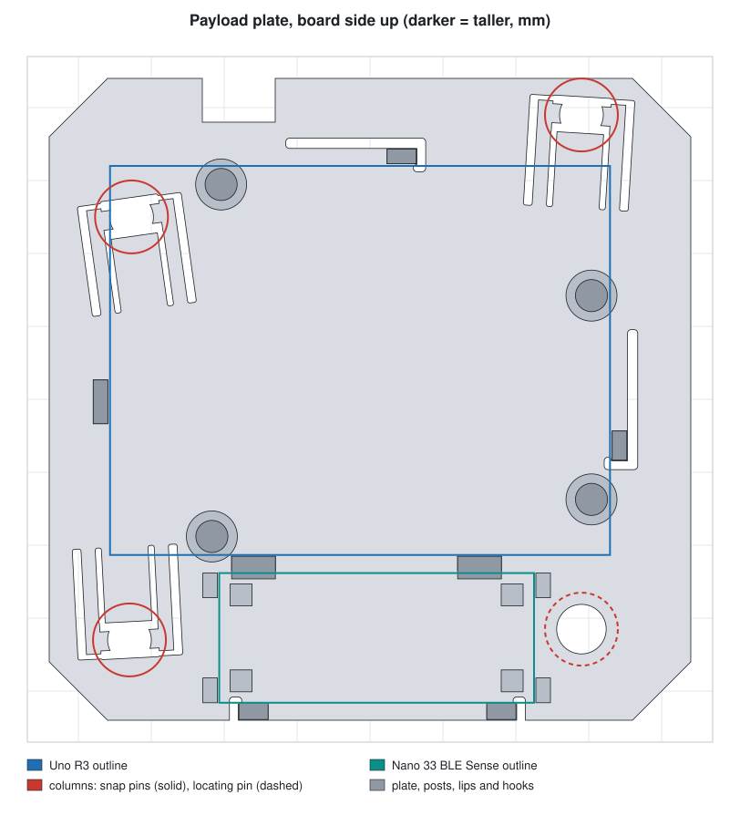

# AMSAT CubeSatSim frame with a printed Arduino payload

A real 1U CubeSat frame (100 × 100 × 113.5 mm) that holds an **Arduino Uno R3**, an **Arduino Nano 33 BLE Sense Rev2** (the bare board, ABX00069) and a **3000 mAh battery** (MakerFocus flat 3.7 V LiPo). Every part is 3D printed, with no screws, springs, metal hardware or tools.

**There are no loose parts.** The whole kit is AMSAT's frame pieces plus two plates: the payload plate and the battery plate. Every snap, hook and lip is part of a plate or the frame, so there is nothing small to drop, lose or throw away by mistake. The rules behind it are in the [design guide](../DESIGN-GUIDE.md).

**Versions:** v1 (the payload plate, printed and tested) is saved as the [`release/amsat-kit-v1`](https://github.com/steelhead99x/cubesat-classroom/tree/release/amsat-kit-v1) branch. This is v1.1: it adds the battery, a second tight snap pin and a cable notch. Two outdoor cases are built from it: the [outdoor ground station](../outdoor-station/README.md) and the [outdoor XIAO station](../outdoor-xiao/README.md).

The frame is the [AMSAT CubeSat Simulator](https://cubesatsim.org) v2.0 frame, unchanged except for one piece. The payload plate and its joints are new, designed around Arduino's own CAD for both boards (see [reference/](reference/)).

## How it holds together

Every joint follows the usual rules for printed snap fits, so it works on a worn or budget printer, not just a tuned one:

- **Every part that flexes bends in the plate's own plane**, along its printed strands, never across its layers.
- **Strain is at most 1.2%**, about 15% of PLA's 8% elongation at break, so a snap can be used over and over without cracking or taking a set.
- **Nothing that flexes or carries load is thinner than 2 mm**, and clearances are 0.4 mm.
- **Every snap closes on an angled face that prints without supports.** It pulls the joint tight whatever the print error, so nothing rattles.
- **Every part has one big flat face** to print on, so Bambu Studio's auto-orient puts it down the right way.

**Plate to frame: keyed snap pins.** Three of the bottom piece's columns end in a pin with two flat sides and a 45° head. The fourth, next to the Nano, has a plain locating pin. Around each snap pin the plate has a keyed slot:

- **Rigid walls face the pin's flats**, so the plate drops on one way only, already centred, and can't turn or slide. Two of the three pins are tight (0.1 mm on each flat), on opposite corners: top right and bottom left. Together they set where the plate sits and stop it turning. The third, top left, has 0.25 mm, so a small error in hole spacing between the frame and the plate can't make it bind.
- **Two straight flex fingers** run either side of the slot, each with a tooth facing the head's round side. A rigid tongue between them stays put.
- **Press straight down:** the head's gentle 30° lead-in spreads the teeth, then they click in under the 45° face. Each tooth stays 0.35 mm out from rest on that face, so the plate is pulled down onto the columns and can't rattle.

It takes about 27 N to pull the plate off, against 16 N for an 80 g payload at 20 g (a common design load for small-satellite launch). The first print used a round pin with curved fingers; it was hard to seat because nothing lined the plate up, so the pin now has flats.

**Both boards: tuck and click.** Each board has fixed lips on one edge and snap hooks on the other. Tuck the lip edge under its lips, then swing the board down: its far edge pushes the hooks out sideways, and they spring back over it. Each hook is a post on an 18 mm finger cut into the plate, so it bends in the plate's plane. The hook's underside is angled 10°, less than the 17° friction angle of PLA on a circuit board, so lifting the board can't push a hook open. To take a board out, push its hooks outward with a fingertip and lift.

- **Uno R3:** stands on four 5.5 mm posts, with short pins in its holes. One lip holds its left edge (between the DC jack and the USB-B socket), and hooks hold its right and top edges, at places Arduino's layout leaves clear.
- **Nano 33 BLE Sense:** lies flat on 1.5 mm pads, parts up. Two lips hold one long edge and two hooks the other. Corner stops keep it from sliding, and leave its USB socket clear.

**The battery: press and click.** The top piece gets the same columns as the bottom (it's the same printed part), and a second keyed plate snaps onto them. The cell lies between two side guides on that plate. Press it straight down: its ends push a snap hook out at each end, and the hooks click back over it. The hooks are the boards' hook with a sturdier post, because they stand the full 14 mm height of the largest cell. The plate holds the largest cell MakerFocus's listing allows (67 × 36 × 12 mm plus 2 mm each way). A smaller cell sits loose by up to 2 mm: stick a strip of foam tape under it. To take it out, push one hook outward and lift that end. The cell's wire leaves beside the top hook and passes the payload plate through the notch in its top edge.




## Credit and license

- **Frame:** AMSAT CubeSatSim v2.0 by Alan Johnston, KU2Y, AMSAT VP Educational Relations. Source: [alanbjohnston/CubeSatSim `hardware/frame/v2.0`](https://github.com/alanbjohnston/CubeSatSim/tree/master/hardware/frame/v2.0), commit `1f6a01c4` (2024-10-07), with the [Onshape CAD](https://cad.onshape.com/documents/ba47819ff100597297d1d967/w/f19409ec7cd5459afb429cb9/e/a0e0cc37dee6fb879c4bcc2b) linked from there.
- **License:** the CubeSatSim repository is GPL-3.0, so everything in this folder is GPL-3.0 too ([LICENSE](LICENSE)). The rest of CubeSat Classroom keeps its MIT or Apache-2.0 terms.
- **Changes:** modified by CubeSat Classroom on 2026-11-25. `bottom-with-columns` is the AMSAT top/bottom piece with four standoff columns added where the AMSAT board stack normally screws in; three end in snap pins and one in a locating pin. The payload plate, battery plate, fit plate and test coupons are new parts. The kit prints `bottom-with-columns` twice: once for the bottom, once for the top. The files in [upstream/](upstream/) are AMSAT's, byte for byte (SHA-256 below).
- **Payload plate design:** modeled on the `Multiplate` from the [Teachers in Space](https://www.tis.org/) (TIS) 1U frame, the frame TIS uses in its Arduino CubeSat workshops. TIS publishes its files without a license, so none are copied here; see [tis/README.md](../tis/README.md).
- This is an independent build. It isn't made or endorsed by AMSAT or TIS.

## What to print

There are three Bambu Studio projects. Open any of them in Bambu Studio (File → Open Project). Each plate has a name and a preview picture, and every part is already in its print orientation. They fit any Bambu Lab printer with a 256 mm bed (P1S, P1P, X1 Carbon, X1E, A1).

| File | Plate | What's on it |
| --- | --- | --- |
| **[p1s/cubesat-test-coupons.3mf](p1s/cubesat-test-coupons.3mf)** (print first) | Test coupons | A snap pin with a fit ladder of three tabs (about 5 g), and the Nano mount on its own (about 4 g) |
| **[p1s/cubesat-kit.3mf](p1s/cubesat-kit.3mf)** | 1. Payload plate and bottom | The payload plate and the bottom piece with columns |
| | 2. Sides | Both AMSAT sides (one with the camera hole), unchanged |
| | 3. Top and battery plate | The same columns piece again, as the top, and the battery plate |
| **[p1s/cubesat-fit-plate.3mf](p1s/cubesat-fit-plate.3mf)** (optional) | Fit plate | The open-truss fit plate |

Before you slice:

- **Printer and process:** the projects keep whatever printer, process and filament you have selected. Pick your printer and nozzle (for example *Bambu Lab P1S 0.4 nozzle*), the matching *0.20mm Standard* process, and PLA. Supports stay off. Auto-orient is fine.
- **Already set in the files:** the coupons print at 100% infill, since they flex. Each part is its own object, so Bambu Studio keeps every part on the plate it was placed on.
- **Colours with an AMS:** the CubeSat Classroom mark and lettering stand 0.6 mm proud of the plate. Add a filament change at **3.0 mm** (white) and another at **3.6 mm** (back to the plate colour), so only they are white.

None of the plates has been sliced for a time estimate yet. For other slicers, every generated part is in [stl/](stl/), already in print orientation.

**Print the test coupons first.** They're the two joints on their own, so a class can check a printer with a few grams of plastic instead of a whole plate:

1. **Snap pin fit ladder:** one pin and three tabs, marked with raised dots on their middle tongue. 1 dot is the kit's fit: 0.1 mm clearance on the flats. 2 and 3 dots are looser (0.2 and 0.3 mm on the flats, with their teeth 0.1 and 0.2 mm further out), for printers that print holes small. Line a tab's slot up with the pin's flats, dots up, and press it straight down until it clicks. The right fit drops onto the flats without forcing, clicks with a firm push, and doesn't wobble or rattle once on. If 2 or 3 dots feels better on your printer, tell us: the kit's fit is one number (`pin_fit`), and the files can be regenerated for it.
2. **Nano mount:** the plate's Nano 33 BLE Sense mount on its own, the same pads, corner stops, lips and hooks in the same places, sized for the bare board (43.18 × 17.78 mm, no headers). Hold the Nano parts up, with its USB end towards the small raised arrow. Tuck the long edge under the two lips, then press the other edge down until both hooks click. It should sit flat on its pads with only a little end play, and lifting it shouldn't pop the hooks. To take it out, push the hooks outward with a fingertip.

**Printed so far (hardware bench, Nov 26, Bambu Lab P1S, PLA):** the coupons printed were the first keyed-pin revision, commit [`1f1eab3`](https://github.com/steelhead99x/cubesat-classroom/commit/1f1eab3) (14 mm fingers, with 0.2 mm as the kit's fit). Of its three tabs, 1 dot fit best, so 0.1 mm is now the kit's fit. The bare Nano 33 BLE Sense Rev2 fit its coupon well and snapped in. The kit plate's slots are the 1-dot tab's: the same flats and teeth. The coupons in this folder differ from that print in one way: the fingers (on the plate and the tabs) are 0.5 mm longer, 14.5 mm, with 0.1 mm more room behind them, to keep the strain under the limit with the tighter teeth. That change hasn't been printed yet.

The coupons don't change when `pin_fit` changes: each tab's flats and teeth are set by its place on the ladder alone, so a coupon printed today matches one printed after a regenerate for another fit. The checks confirm every tab's fingers stay under the 1.2% strain limit, at every kit fit on the ladder.

Write down what you find and share it through the [contribution guide](../../CONTRIBUTING.md).

**The fit plate** has the payload plate's posts, pads, lips, hooks, snap slots and branding, made by the same code and in the same places, on an open triangular truss instead of a solid deck: 14.9 cm³ of plastic instead of 23.2 cm³. A fit you check on it holds for the real plate, and it snaps onto the bottom piece the same way. It also makes a display piece for photos and school projects: dark grey or black with white lettering looks most like flight hardware.

The lettering is stored as outlines in [label.json](label.json) (DejaVu Sans Bold), and the mark is drawn from the shapes in [docs/mark.svg](../../docs/mark.svg).

## Assemble

1. **Plate onto the frame:** set the plate, board side up, over the bottom piece's four columns, the locating pin by the Nano's corner. The slots only line up with the pins' flats one way round. Press straight down over each column until all three snap pins click.
2. **Uno R3:** tuck its left edge (USB-B and DC jack side) under the lip, line its holes up with the pins, and press the right side down until both hooks click.
3. **Nano 33 BLE Sense** (bare board, parts up, USB end towards the right): tuck the long edge nearest the Uno under the two lips, then press the other long edge down until both hooks click.
4. **Battery plate onto the top:** press it onto the top piece's columns the same way as the payload plate (one way round, three clicks).
5. **Battery:** a mentor checks the cell first (see the [battery safety quest](../../quest/m1/battery-safety.md)). Lay it between the guides, wire towards the gap beside the top hook, and press it straight down until both end hooks click.
6. **Frame:** snap the two sides onto the bottom, then the top, the same way as AMSAT's frame. Run the battery wire down the frame's side and through the payload plate's notch. AMSAT notes the frame holds together on its own. Skip their optional screws to keep it 100% printed.

To take a board out, push its hooks outward and lift that edge, then slide the other edge out from under its lips. To take the plate out, pull it straight off the columns.

The Nano's USB plug needs room beyond the plate edge. Use a right-angle Micro-USB cable if a side panel is in the way.

**Power:** the cell gives 3.0 to 4.2 V, and both boards need 5 V (the Uno on USB, the Nano on USB or VIN, which needs at least 4.5 V). Run them from the cell through a LiPo charger with a 5 V boost output, such as Adafruit's PowerBoost 1000C. That board doesn't have a printed mount in this kit yet. Until it does, hold it to the battery plate with foam tape, away from the snap fingers.

## How it fits

| Check | Value |
| --- | --- |
| Plate | 88 × 88 × 3 mm with 8 mm corner chamfers (AMSAT's boards are 90.5 mm), 23.2 cm³ |
| Plate position | 15 mm inside the bottom face, below AMSAT's 12 mm snap tabs |
| Snap pins | 6 mm shaft and 7.4 mm head, 4.8 mm across the flats, with a 45° underside and a 30° lead-in. Walls 0.1 mm off each flat at the two tight pins (top right and bottom left), 0.25 mm at the third. Two straight fingers per pin, 14.5 mm long and 2 mm wide, bend 0.83 mm in the plate's plane to let a head pass (1.19% strain, limit 1.2%). The teeth stay 0.35 mm out from rest on the 45° face. About 27 N to pull the plate off three pins. |
| Battery | The largest cell allowed, 69 × 38 × 14 mm, between guides 0.5 mm off its sides, with a hook over each end: 2.4 mm posts 8 mm wide. At 20 g with a factor of safety of 2, each post sees under 3 MPa across its layers (assumed allowable 15 MPa). The battery plate's three snap pins hold about 27 N against a 16 N launch load. |
| Board hooks | 18 mm fingers, 2.2 mm wide. Each hook reaches 0.8 mm over the board edge, bending its finger 0.92% to let the board pass. Underside at 10° with 0.1 mm preload, about 2.7 N down per hook. |
| Lips | 6 mm wide with a 45° underside, reaching 0.8 mm over the board edge. |
| Uno R3 | On 5.5 mm posts with 2.9 mm locating pins. One lip on the left edge, hooks on the right and top edges. |
| Nano 33 BLE Sense Rev2 | 43.18 × 17.78 × 1.59 mm (from Arduino's CAD), flat on 1.5 mm pads with 0.5 mm end play between its corner stops. Two lips and two hooks. |

The checks in [crates/amsat-kit/src/checks.rs](../../crates/amsat-kit/src/checks.rs) build the parts and fail if:

- a snap finger or hook finger would bend more than 1.2%, or anything that flexes or carries load is thinner than 2 mm
- the snap pins' flats are cut too deep (under 4 mm across), the teeth run onto the flats, the fit is outside 0.05 to 0.4 mm, fewer than half the pins are tight, the tight pins aren't on opposite corners, every pin is tight, or the plate can slide on its columns
- the battery doesn't fit between its guides, can slide out from under its hooks, can't be pressed in, hits a column, or its posts or snap pins are too weak for the launch load
- a snap pin's slot comes within 2 mm of the plate edge
- the snap-pin teeth would meet a head less than 0.2 mm out from rest (so print error could leave it loose), or too near the head's edge to hold, or the three pins hold less than 1.5 times the payload's weight at 20 g
- the plate hits the columns or the AMSAT piece or its snap tabs, or reaches past the plate outline into the frame's corner rails
- any part stands on a set of flex fingers or a hook finger
- a hook underside isn't safely under the friction angle, or a hook or lip reaches less than 0.6 mm over its board
- a board can't be swung down past its hooks from under its lips, isn't held once seated, or hits a post, pad, lip or hook
- anything hits a part in Arduino's layout for either board, a column's pin head comes up under the Uno's solder joints, or anything blocks the Nano's USB plug or leaves less than 20 mm from it to the plate edge
- any of the three fit tabs doesn't go on, press, and sit at its own clearance on the flats, or the bare Nano doesn't go into its coupon and stay held the same way as on the plate

`cargo run --release -p amsat-kit -- self-test` (and `cargo test -p amsat-kit`) breaks the classroom kit twenty-five ways and the outdoor cases fourteen ways, and checks that each one is caught, and that hook fingers exactly at the strain limit still pass.

**Verification status: nearly verified.** The design checks above pass in CI, and the keyed-pin fit ladder and the Nano coupon have printed well (see above). The kit plates, the battery plate and the fit plate in this version haven't been printed yet. The checks are design checks, not measurements, and the strain and force figures are hand calculations for PLA (straight-beam estimates), not test results. Print the coupons first and share what you find through the [contribution guide](../../CONTRIBUTING.md).

## Regenerate

The CAD, the checks, the Bambu Studio projects and the drawings are all Rust, in [crates/amsat-kit](../../crates/amsat-kit). From the repository root:

```sh
cargo run --release -p amsat-kit               # check, then write all three cases' stl/ and p1s/, and the drawings
cargo run --release -p amsat-kit -- check      # checks only
cargo run --release -p amsat-kit -- self-test  # every broken design must fail the checks
```

The output is the same byte for byte on every run, and CI fails if the committed files differ from it. It uses [manifold-csg](https://crates.io/crates/manifold-csg), the same geometry kernel as the earlier Python version.

To rebuild the reference board models in [reference/](reference/), follow [reference/README.md](reference/README.md).

The website renders (`render-exploded.png`, `render-exploded-dark.png`, `render-exploded-navy.png` and `render-assembled.png`) still show an earlier version of the payload, and the Python script that drew them has been removed. A Rust renderer for them is a follow-up.

Upstream checksums (SHA-256):

```
34c9737cd7a26b5df9b34df2227ffc6aecfdbc02061d5a5a1234c1b2ddb30784  upstream/cubesatsim_frame_side.v2.0.stl
df1d094d1110f4a5d77c2b580937f8cb6df850ceacb43847701be3b9036afa04  upstream/cubesatsim_frame_side_camera.v2.0.stl
8f6ffc3367aca32192878f5a98caab0e6d6c74b85a1ea21323669c52d9d81d21  upstream/cubesatsim_frame_top_bottom.v2.0.stl
```
