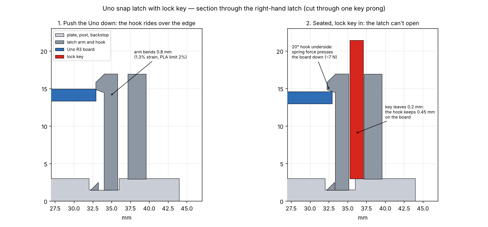

# AMSAT CubeSatSim frame with a printed Arduino payload

A real 1U CubeSat frame (100 × 100 × 113.5 mm) that holds an **Arduino Uno R3** and an **Arduino Nano 33 BLE Sense Rev2** (the bare board, ABX00069). Every part is 3D printed, including the screws and lock keys: no metal hardware.

The frame is the [AMSAT CubeSat Simulator](https://cubesatsim.org) v2.0 frame, unchanged except for one piece. The payload plate, clamps, screws and snap columns are new parts designed for this kit. They're designed around Arduino's own CAD for both boards (see [reference/](reference/)).

**How the boards are held.** No board relies on a flexing part alone. Real CubeSats hold boards rigidly, because a snap that relies only on its own spring can work loose under launch vibration. The Uno's latches flex to snap in, then a lock key stops each one from opening again.

- **Uno R3:** snaps in with no tools. Short pins in its four holes locate it, and four latches click over its edges at the only places Arduino's layout leaves the edge clear. Each hook's underside is angled 20°, so the arm's spring presses the board down onto its posts (about 7 N per latch) and it can't rattle. Then a red **lock key** drops in behind each latch and clips into place. With the key in, a latch can open only 0.2 mm, so it can't let go, the same idea as the secondary lock on an aerospace connector. If a key won't go in, that corner of the board isn't seated.
- **Nano 33 BLE Sense:** it stands on its long edge like a card in a card cage. V-grooves grip the bottom and top edges along their whole length, and stops at both ends keep it from sliding. The top groove is in a clamp that is screwed down, pressing both edges into their V's so the board has no play. The board's own parts face into the CubeSat and never touch the holder.
- **Screws:** the Nano's clamp uses two printed screws. The bottom 3 mm of each pillar hole is slightly undersized, so the screw grips there like a nylon locknut and won't vibrate loose.




## Credit and license

- **Frame:** AMSAT CubeSatSim v2.0 by Alan Johnston, KU2Y, AMSAT VP Educational Relations. Source: [alanbjohnston/CubeSatSim `hardware/frame/v2.0`](https://github.com/alanbjohnston/CubeSatSim/tree/master/hardware/frame/v2.0), commit `1f6a01c4` (2024-10-07), with the [Onshape CAD](https://cad.onshape.com/documents/ba47819ff100597297d1d967/w/f19409ec7cd5459afb429cb9/e/a0e0cc37dee6fb879c4bcc2b) linked from there.
- **License:** the CubeSatSim repository is GPL-3.0, so everything in this folder is GPL-3.0 too ([LICENSE](LICENSE)). The rest of CubeSat Classroom keeps its MIT or Apache-2.0 terms.
- **Changes:** modified by CubeSat Classroom on 2026-11-25. `bottom-with-columns` is the AMSAT top/bottom piece with four standoff columns added where the AMSAT board stack normally screws in, filling the four 3.2 mm stack holes. The payload plate, clamps, screws and snap test are new parts. The files in [upstream/](upstream/) are AMSAT's, byte for byte (SHA-256 below).
- This is an independent build. It isn't made or endorsed by AMSAT.

## What to print

Use the P1S profile for your nozzle (0.20mm Standard for 0.4 mm, 0.30mm Standard for 0.6 mm), PLA, and **supports off**. Each 3MF opens with every part already in its print orientation.

| Plate | Parts | 0.6 mm nozzle |
| --- | --- | --- |
| [01-snap-test](p1s/01-snap-test.3mf) | Short snap column and a tab with the snap hole | 5 min, 2 g |
| [02-sides](p1s/02-sides.3mf) | AMSAT side and side with camera hole | 1 h 40 min, 58 g |
| [03-top-and-bottom](p1s/03-top-and-bottom.3mf) | AMSAT top (unchanged) and bottom with snap columns | 1 h 18 min, 48 g |
| [04-payload-plate](p1s/04-payload-plate.3mf) | Payload plate with the Uno latches, and the lower clamp (the Nano's cap) | not yet sliced |
| [05-fit-plate](p1s/05-fit-plate.3mf) (optional) | Fit plate and lower clamp: the payload plate's mounts on an isogrid display panel, about 80% of the plastic | not yet sliced |
| [06-keys-and-screws](p1s/06-keys-and-screws.3mf) | Four Uno lock keys and two screws. Print the keys in red, like flight safety pins. | not yet sliced |

Plates 01–03 were sliced with a 0.6 mm nozzle. Plates 04–06 changed on 25 November 2026 and haven't been sliced yet. The lower clamp prints upside down (flat top on the bed), the screws print head down, and the keys print flat.

**Print the snap test first.** Push the peg into the tab. It should click in with a firm push and not fall out. If it's too tight or too loose, change `SNAP_HOLE` in [generate.py](generate.py) by 0.1 mm and regenerate (see below). The generator refuses a hole that leaves less than 0.2 mm of barb overlap, because the peg would no longer latch. The payload plate's four snap columns use the same snap. The first test print on a P1S with a 0.6 mm nozzle snapped well at the default size.

**Then, if you like, print the fit plate and plate 06.** The fit plate has the payload plate's posts, pillars and Nano card cage, made by the same code and in the same places, so a fit you check on it holds for plate 04. It has no snap holes. Check that the Uno clicks in and every key clips in, that the Nano goes in, and that both screws tighten, before you print plate 04.

The fit plate also makes a display piece for photos and school projects. It's a 2.4 mm isogrid panel, the triangular rib pattern used on rocket and satellite structures, with a bevelled rim. It has a raised CUBESAT CLASSROOM nameplate under the Uno and a +X/+Y axis marker like a spacecraft body frame. The lettering, nameplate border and arrows stand 0.6 mm proud, so two colours are easy:

- In Bambu Studio, add a filament change at **2.4 mm** (white) and another at **3.0 mm** (back to the panel colour), so only the lettering is white.
- With an AMS, Studio does both changes automatically. Without one, the printer pauses for each swap.
- Dark grey or black for the panel, with white lettering, looks most like flight hardware.

To change the wording, edit `LINES` in [label.py](label.py), run it (it needs `matplotlib` for its bundled DejaVu Sans Bold font), then regenerate. The CAD reads the outlines from `label.json`, so `generate.py` itself doesn't need matplotlib.

**Test one screw first.** It should turn in easily, then get firm over the last 3 mm, where the locking band starts. If it won't go into the band, lower `LOCK_INTERFERENCE` in [generate.py](generate.py) from 0.1 to 0.05. If it spins freely all the way down, raise it to 0.15. Then regenerate.

## Assemble

1. **Uno R3:** line its holes up with the four pins, USB-B towards the plate edge on the left, and press straight down near each corner until all four latches click. Then push a lock key into the slot behind each latch, ring hole up, until it clicks. A key that won't go in means that corner isn't seated: press the board down there and try again.
2. **Nano 33 BLE Sense** (bare board, parts facing the Uno, USB to the left): lower it into the V-groove on the plate so its USB end sits against the small corner stop and its other end against the end wall.
3. **Lower clamp:** set it on so its groove takes the Nano's top edge, then screw it down at both pillars. The Nano should now be held tight with no play. The clamp doesn't touch the Uno, so either board comes out on its own.
4. **Plate into the frame:** turn the plate over and press it onto the four columns of the bottom piece until all four snaps click.
5. **Frame:** snap the two sides onto the bottom, then the top, the same way as AMSAT's frame. AMSAT notes the frame holds together on its own. Skip their optional screws to keep it 100% printed.

To take the Uno out, pull the four keys (a loop of ribbon through each key's hole helps), push each latch outward a little and lift the board. To take the Nano out, undo the clamp's two screws.

The Nano's USB plug needs about 28 mm to the left of the board, and it ends about 1 mm inside the plate edge. Use a right-angle Micro-USB cable if a side panel is in the way. The Nano's sensors face the Uno, 15 mm away, so the light sensor sees the inside of the CubeSat. Take the side panel off for light lessons.

## How it fits

| Check | Value |
| --- | --- |
| Plate | 88 × 88 × 3 mm with 8 mm corner chamfers (AMSAT's boards are 90.5 mm) |
| Plate position | 15 mm inside the bottom face, below AMSAT's 12 mm snap tabs |
| Snap peg | 5.0 mm shank, 5.7 mm barb, 1.4 mm split, into a 5.2 mm hole |
| Uno R3 | On 10 mm posts with 2.9 mm locating pins. Four latches 8 mm wide. The 1.8 mm arms are 13.1 mm long, rooted in 1.5 mm pockets in the plate. The hook reaches 0.8 mm, which bends the arm 1.3% snapping in, under a 1.5% limit because the arms print upright and bend across their layers. The hook underside is at 20° with 0.15 mm preload, about 7 N down per latch. Lock keys are 1.8 mm thick with 0.1 mm clearance each side, so a latch opens at most 0.2 mm and keeps 0.45 mm of grip. The keys clip in with two 0.35 mm detents (1.5% prong strain). |
| Nano 33 BLE Sense Rev2 | 43.18 × 17.78 × 1.59 mm (from Arduino's CAD), on edge in V-grooves 2.4 mm wide at the mouth, 1.4 mm at the bottom and 2.0 mm deep. Each edge sits 1.62 mm in. 0.5 mm end play between the stops (the first fit print at 0.2 mm was a little tight). |
| Screws (Nano clamp) | Round thread, 6.5 mm crest, 4.5 mm root, 2.5 mm pitch, 10 mm engaged. 0.25 mm clearance, then a 3 mm band with 0.1 mm interference. Pillars 10 mm, leaving a 1.5 mm wall. |
| Clamping | Pillar tops sit 0.3 mm below the Nano clamp, so tightening the screws pulls it down onto the board, like a machinist's strap clamp |
| Snap peg strain | 0.8%, under a 2% limit for PLA |

[generate.py](generate.py) assembles the parts in frame coordinates and fails if:

- the plate holes don't line up with the columns, or the plate hits the AMSAT piece or its snap tabs
- any part sits where a snap barb comes through, or reaches past the plate outline into the frame's corner rails
- a latch, key or pillar hits any Uno part listed in Arduino's layout (headers, jacks, ICSP, the ATmega socket, capacitors, crystal, reset button, …), or something sits under its solder joints. These checks use the latches bent to their seated position.
- a latch's hook doesn't reach over the board, the board can't be pushed down past the latches bent open, or a latch arm would bend more than 1.5%
- a lock key doesn't fit its latch, a latch could open past its key, or a key leaves a latch more than half its grip to open
- the key prongs would bend more than 2%, or their slot is too narrow for the detents
- a groove wall, stop or clamp touches a part on the Nano, or the V-groove walls reach its parts
- the Nano could move 0.3 mm in any direction (up, down, either side, or along it past its end play), or either groove alone fails to hold it sideways
- the Nano can't be lowered into its groove with the clamp off, or the Uno onto its posts
- anything blocks the Nano's USB plug, or there's less than 20 mm from its USB to the plate edge
- a pillar wall around a screw is under 1.2 mm, the thread engages less than 1.5 diameters, or the pitch is too fine to print
- a peg would bend more than PLA can take over and over

`python generate.py --self-test` breaks the design twelve ways and checks that each one is caught, and that a design exactly at a limit still passes.

Not yet checked on a real print: the Uno latches and keys, the screw locking band and the Nano's grip. Report what you find with the [P1S case quests](../../quest/README.md#bambu-p1s-case-test-track).

## Regenerate

```sh
python3 -m venv /tmp/cubesat-cad
/tmp/cubesat-cad/bin/pip install -r hardware/requirements.txt
/tmp/cubesat-cad/bin/python hardware/amsat-cubesatsim/generate.py
/tmp/cubesat-cad/bin/python hardware/amsat-cubesatsim/prepare.py
```

To redraw the layout image and the latch section, install `matplotlib` too and run `python layout.py` and `python latch_section.py` from this folder.

To rebuild the reference board models in [reference/](reference/), follow [reference/README.md](reference/README.md).

Upstream checksums (SHA-256):

```
34c9737cd7a26b5df9b34df2227ffc6aecfdbc02061d5a5a1234c1b2ddb30784  upstream/cubesatsim_frame_side.v2.0.stl
df1d094d1110f4a5d77c2b580937f8cb6df850ceacb43847701be3b9036afa04  upstream/cubesatsim_frame_side_camera.v2.0.stl
8f6ffc3367aca32192878f5a98caab0e6d6c74b85a1ea21323669c52d9d81d21  upstream/cubesatsim_frame_top_bottom.v2.0.stl
```
