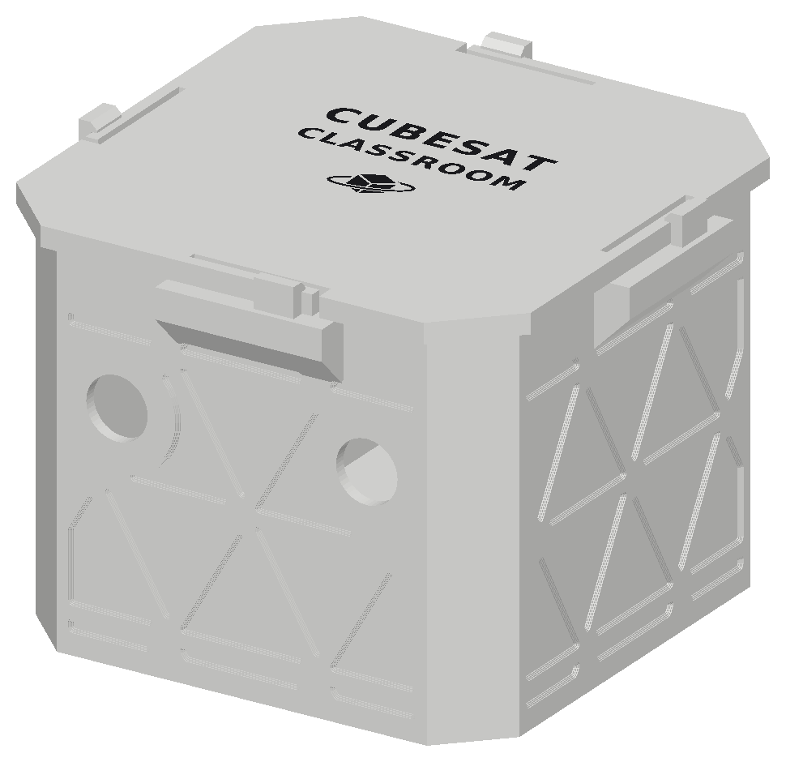

# Outdoor ground station (beta): Uno R3, Nano 33 BLE Sense and a 3000 mAh battery

The [classroom kit](../amsat-cubesatsim/README.md)'s payload, sealed in a box for outdoors. The box has the same columns and keyed snap pins inside, so the **same payload plate** snaps in, with the Uno R3 and the bare Nano 33 BLE Sense Rev2 on it exactly as in the kit. The 3000 mAh battery lies under the plate. A **1/4"-20 camera thread** in the middle of the back takes a tripod. **No screws anywhere:** the lid presses down over an O-ring and latches on, and comes off again by hand. The rules behind it are in the [design guide](../DESIGN-GUIDE.md).

**Status: beta.** The design checks pass, and the outdoor test coupons have printed and work in PLA (see "Printed so far" below). The box and lid haven't been printed, and nothing here is a water test. Don't trust the seal until the box has been tested: see "Test it" below.

## How it goes together

- **Plate:** the kit's payload plate snaps onto the box's columns the same way it snaps onto the AMSAT frame: one way round, three clicks. Two pins are tight, on opposite corners.
- **Battery:** the largest cell MakerFocus's listing allows (67 × 36 × 12 mm plus 2 mm each way) lies in a walled pocket on a deck under the plate. The plate sits 0.5 mm above it, so once the plate is on the cell can't move, and there are no extra parts to hold it. The wire leaves the pocket's top end and comes up through the notch in the plate's top edge.
- **Seal:** a skirt under the lid drops into the box's opening. A 2.5 mm nitrile O-ring sits in a groove round the skirt and is squeezed 24% sideways against the box wall (18–30% seals without crushing it); the groove is 73% full. This is a radial seal, like a jar lid's: it needs no clamping force, so nothing has to screw down. The O-ring is the one separate piece, and it stays in its groove.
- **Lid:** press it straight down. A flex finger cut into each of the lid's four edges rides over a lug on the rim's 45° lead-in and clicks under it. To open, press each finger inward toward the centre of the lid and lift. The fingers bend 0.99% (the limit is 1.2%), so the lid can go on and off again and again. The CubeSat Classroom mark and lettering are inlaid flush in the lid's top face, in the second colour.
- **Ports** are in the wall that faces down on a tripod, so rain runs off them: an M12 × 1.5 cable gland for a USB cable (3–6.5 mm), and an M12 × 1.5 breathable membrane vent, which stops condensation and pressure changes from pumping water past the seal.
- **Tripod:** a 1/4"-20 UNC thread printed straight into a sealed boss in the middle of the back, 9 mm deep. It stops 2 mm short of the inside, so it can't let water in. Tilt the tripod head so the lid faces out and the ports face down.

## What to print

| File | Plate | What's on it |
| --- | --- | --- |
| **[p1s/outdoor-test-coupons.3mf](p1s/outdoor-test-coupons.3mf)** (print first) | Test coupons | The tripod-thread coupon, the [two-latch coupon](#two-latch-coupon), and the snap pin with its fit ladder |
| **[p1s/outdoor-station.3mf](p1s/outdoor-station.3mf)** | 1. Box | The box (108 cm³) |
| | 2. Lid and payload plate | The lid (36 cm³) and the kit's payload plate |

- **Two colours:** load white in AMS slot 1 and black in slot 2. Every part, coupons too, carries the CubeSat Classroom logo in the other colour (white case parts get a black logo; the black plate gets a white one): inlaid 0.9 mm, and raised 0.6 mm on an upward face wherever nothing mounted sits over it. Sized for a 0.6 mm nozzle, so it prints on a 0.4 mm one too. One colour still works, and the raised logo still shows. Each coupon also has a label tile saying what it tests and how to try it (TRIPOD THREAD, LID LATCH, SNAP PIN, FIT 1 to 3). The labels are new and haven't been printed yet; the joints behind them are the ones printed below.
- **Material:** ASA or PETG for a box that lives outside: PLA softens in summer sun. PLA is fine for a first test box, to check the fit, the latches and the seal indoors. The fit ladder was tuned in PLA, so print the pin coupon again in your outdoor material and check which tab fits best.
- **Supports:** none. The box prints on its back; the lid prints upside down, on its top. The rim's overhang under each lug has a 45° slope under it, the isogrid pockets in the upright walls have 45° sides (printed as 0.2 mm steps), and the deck under the battery is bridged between ribs up to 16 mm apart.
- **Tripod-thread coupon:** two sockets in a block as thick as the box's boss. The plain one is the box's thread. The one with a dot is 0.15 mm looser, for printers that print holes small. Screw your tripod's screw into each. If the plain one is too tight and the dotted one is right, tell us: the box's thread is one number (`thread_clear`), and the files can be regenerated for it.

### Two-latch coupon

Both outdoor kits use this small box and lid, made by the same code as the real ones: the same rim, lugs, skirt, O-ring groove and latch fingers, with two latches on opposite sides instead of four. It's cut down to save plastic, about 21 cm³ for both with their label tiles: the box is a 59 mm open ring only as tall as the skirt, its flange is only where the lugs stand, and the lid is a frame whose middle is a thin 1.2 mm web. Each carries the logo and words on its label tile. The lid prints upside down.

1. Line up the lid's fingers with the box's lugs and press the lid straight down until both latches click.
2. Pull up gently on the lid. Both latches should hold.
3. Push both fingers inward toward the centre with your thumbs and lift. The lid should come off. If it takes too much force or won't catch, tell us so we can check `latch_slit` and `lug_reach`.

An O-ring is optional (2.5 mm cord, about 43 mm inside diameter). The lid has a little more play without one.

**Printed so far (hardware bench, Nov 26, Bambu Lab P1S, PLA):** the outdoor test coupons. The first latch coupon was a chunk of rim and a chunk of lid, and it didn't work as a test: with nothing holding the lid chunk square, the lug just pushed it aside instead of bending the finger. It was replaced by the small box and lid above (Nov 27), which printed well in PLA and work: the lid presses on, clicks and holds. Since that print, the lid's open middle has become a thin web and both pieces have gained label tiles; the latches didn't change. On the pin ladder, 1 dot still fits best. On the tripod-thread coupon, the plain socket (the box's thread) works with a tripod screw. So nothing in the design changed. Next: a first box and lid in PLA, to check the fit and do the water test indoors, then ASA for the box that lives outside (print the coupons again in ASA first and check the same things). The box carries the CubeSat Classroom mark and words on its back, and the lid on its top. The box and lid haven't been printed or water-tested yet.

Every part is also in [stl/](stl/), in print orientation.

## Buy

| Part | Notes |
| --- | --- |
| MakerFocus flat 3.7 V 3000 mAh LiPo, JST PH 2.0 | Protected cell. Check the plug's polarity before connecting it. |
| LiPo charger with a 5 V boost output, such as Adafruit's PowerBoost 1000C | The Uno and Nano need 5 V; the cell gives 3.0–4.2 V. It fits beside the battery under the plate, in a space about 26 × 60 × 24 mm. It has no printed mount yet: hold it with foam tape. |
| M12 × 1.5 cable gland, for 3–6.5 mm cable | Its hole is 12.3 mm, on a flat part of the wall. |
| M12 × 1.5 breathable membrane vent | Also called a protective vent. |
| Nitrile O-ring, 2.5 mm cord, about 102 mm inside diameter | The groove is 331 mm round at the bottom. A 100–104 mm ID ring works; so does 2.5 mm nitrile O-ring cord, cut to 331 mm and joined with cyanoacrylate (a mentor step). |
| A short right-angle Micro-USB cable, or jumper wires to the Nano's VIN | A straight plug sticks out too far for the box. |

## Assemble

1. A mentor checks the battery (see the [battery safety quest](../../quest/m1/battery-safety.md)).
2. Screw in the cable gland and the vent, from outside.
3. Put the battery in its pocket, wire towards the top end, and the boost board beside it. Plug the battery into the boost board, and plug the boost board's USB cable in.
4. Run the cable up through the plate's notch and snap the plate onto the columns (one way round, three clicks). Fit the Uno and the Nano as in the kit.
5. Roll the O-ring into the groove round the lid's skirt, without twisting it. A smear of silicone grease helps it slide.
6. Line the lid's fingers up with the lugs and press the lid straight down until all four click.

## Test it

Before it goes outside, test the box empty: close it with a dry paper towel inside, then spray it all over with a garden hose for five minutes, or hold it under water in a bucket for a minute. Open it and check the towel. Write down the result as a hardware bench test. A wet towel means the O-ring, the latches or a port need work: tell us.

## How it fits

| Check | Value |
| --- | --- |
| Box | 96.8 mm across the walls (110.8 mm at the lugs), 80 mm tall with the lid. Walls and back 2.4 mm, with crisp mitred chamfers outside. Inside, a 92 mm square with 10 mm corner chamfers and 5 mm rounds: the plate has at least 1 mm all round. |
| Isogrid | Each wall's outside face has triangular pockets 0.8 mm deep on 30 mm triangles, between flush 2 mm ribs, leaving a 1.6 mm skin (four 0.4 mm perimeters). The top 12 mm (where the skirt and O-ring press), the bottom 4 mm, and a flat pad round each port's outside body stay solid. The rim's flange is only under the four lugs. The lid has the same isogrid in its underside, inside the skirt, under a 1.6 mm top skin. Together the box and lid are 144 cm³ (about 180 g of PLA), 29% less than the solid case (203 cm³). |
| Plate | On the columns 27 mm above the back: the deck (12.5 mm), the largest cell (14 mm) and 0.5 mm clearance |
| Seal | 2.5 mm O-ring, 1.9 mm gland (0.3 mm skirt clearance), 5 mm groove: squeezed 24%, 73% full |
| Latches | Four, one on each edge: 2.4 mm fingers, 20 mm from root to lug, 1.4 mm slit, 1.0 mm catch on the lug |
| Tripod thread | 1/4"-20 UNC, cut 0.3 mm larger on the diameter for printing, 9 mm long, 2 mm of plastic sealing it from the inside |
| Ports | M12 gland and vent at 48 mm up the wall that faces down, 25 mm either side of the middle |

The checks in [crates/amsat-kit/src/outdoor_checks.rs](../../crates/amsat-kit/src/outdoor_checks.rs) fail if:

- the walls or back are under 2.4 mm, the O-ring is squeezed outside 18–30% or overfills its groove, or the skirt is too thin
- a latch finger bends more than 1.2%, its slit runs into the skirt, its lug misses the rim or barely catches, the lid can't be pushed on, or the lid rattles
- the plate doesn't fit the box with 1 mm all round, or doesn't snap onto its columns the same way as in the kit
- the battery doesn't fit its pocket, can slide about, or isn't held down by the plate
- the boards or their parts hit the box or stand too tall for the lid
- the isogrid skin is under 1.6 mm, its ribs under 2 mm, its pockets reach up where the O-ring presses, the lid's skin is under 1.6 mm, or a pocket sits under a port's seal
- a port runs onto a corner or the slope under the rim, its nut hits anything inside, or two ports are too close
- the tripod thread breaks into the box, or is too short to hold

The self-test (`cargo run --release -p amsat-kit -- self-test`) breaks the outdoor cases twenty-four ways and the latch coupon two ways, and checks that each one is caught. These are design checks, not measurements.

## Regenerate

From the repository root, `cargo run --release -p amsat-kit` builds all three cases. Box sizes, ports and the thread are in `Outdoor` in [outdoor.rs](../../crates/amsat-kit/src/outdoor.rs).
