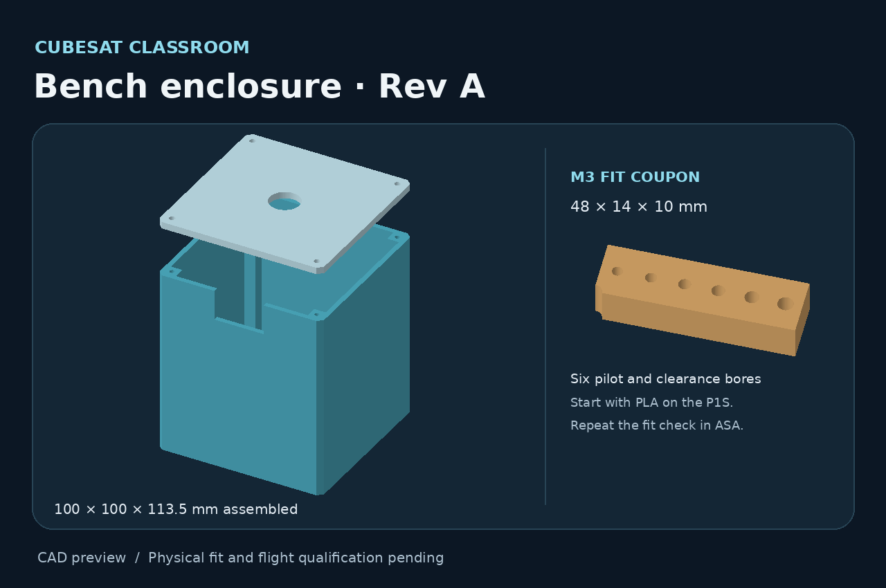

# Print the CubeSat case on a Bambu Lab P1S

A 1U-sized bench case in three prints: a small screw-fit coupon, the case shell and a lid with a camera hole. PLA, stock settings, no supports.



## What you need

- Bambu Lab P1S with a 0.4 or 0.6 mm nozzle, and Bambu Studio
- About 170 g of PLA with a 0.4 mm nozzle, or 215 g with a 0.6 mm nozzle
- 4 × **M3 × 12 mm** screws, socket or pan head (M3 × 10 also works; do not go longer than 14 mm or they bottom out)
- A matching hex key or screwdriver, and calipers or a ruler if you have them

## Slicer settings

| Setting | 0.4 mm nozzle | 0.6 mm nozzle |
| --- | --- | --- |
| Printer | Bambu Lab P1S 0.4 nozzle | Bambu Lab P1S 0.6 nozzle |
| Process | 0.20mm Standard | 0.30mm Standard |
| Filament | Your PLA preset | Your PLA preset |
| Plate | The one installed | The one installed |
| Supports | Off | Off |

Pick the printer preset that matches the nozzle actually installed, and leave everything else at the defaults. A 0.6 mm nozzle prints small holes slightly undersized, so the coupon test matters more. Each 3MF opens already centered and in the right orientation, so don't rotate it.

## Print 1: fit coupon

[01-m3-fit-coupon.3mf](01-m3-fit-coupon.3mf) · about 20 min and 4 g (0.4 mm) · 12 min and 5 g (0.6 mm)

A 48 × 14 × 10 mm bar with six holes. Starting at the notched end they are **2.6, 2.8, 3.0, 3.2, 3.5 and 3.8 mm**.

Test it with one of your screws before printing the case:

- **2.8 mm hole:** the screw should thread in with firm resistance and not crack the plastic. The shell uses this size.
- **3.5 mm hole:** the screw should slide through freely. The lid uses this size.

If either one fails, see [If the screw doesn't fit](#if-the-screw-doesnt-fit) before you print the shell.

## Print 2: case shell

[02-case-shell.3mf](02-case-shell.3mf) · about 4 h and 135 g (0.4 mm) · 2 h 20 min and 175 g (0.6 mm)

100 × 100 × 109.5 mm, prints floor down and open end up. In the Preview tab, check that the four corner screw holes and the cable slot at the top of one wall look clean.

## Print 3: camera lid

[03-camera-lid.3mf](03-camera-lid.3mf) · about 45 min and 26 g (0.4 mm) · 30 min and 32 g (0.6 mm)

100 × 100 × 6 mm, prints flat face down with the four small tabs pointing up.

To print the shell and lid in one job, import both files into one Bambu Studio project and press **Arrange**. They fit together on the 256 mm plate.

The times above are estimates at P1S speeds. Bambu Studio's own estimate is the one to plan around.

## Assemble

1. Let the parts cool before you take them off the plate.
2. Set the lid on the shell with the tabs facing down into the opening. It fits in any of the four rotations.
3. Drive in the four screws until they're snug. PLA strips easily, so stop as soon as the lid stops moving.

The lid should sit flat without forcing, and the closed case should measure about **100 × 100 × 113.5 mm**.

Inside there's about 94 × 94 mm of floor and 105 mm of height, with a 7 mm square screw post in each corner. Run cables through the 30 × 18 mm slot. A camera looks out through the 18 mm hole in the lid.

## If the screw doesn't fit

The hole sizes are set in [generate.py](../generate.py). Change `M3_PILOT` (shell, default 2.8) or `M3_CLEARANCE` (lid, default 3.5) to the coupon hole that worked, then rebuild the files:

```sh
python3 -m venv /tmp/cubesat-cad
/tmp/cubesat-cad/bin/pip install -r hardware/requirements.txt
/tmp/cubesat-cad/bin/python hardware/generate.py
/tmp/cubesat-cad/bin/python hardware/p1s/prepare.py
```

Reprint the part you changed.

## Next

- Put a sensor inside. The [first reading quests](../../quest/README.md#start-with-what-you-have) cover Arduino, XIAO and Raspberry Pi.
- Share your print. The [P1S case quests](../../quest/README.md#bambu-p1s-case-test-track) say what to measure so another crew can repeat it.
- ASA: print the coupon again with the filament maker's profile and ventilation advice before trying a full shell.

The plain STLs are in [../stl](../stl) ([coupon](../stl/m3-fit-coupon.stl), [shell](../stl/bench-shell.stl), [lid](../stl/camera-lid.stl)) for other slicers.

This is a bench case for learning and fit tests, not flight hardware. The [Rev B rail-fit set](../README.md#rev-b-rail-fit-set) is the separate flight-structure experiment.
