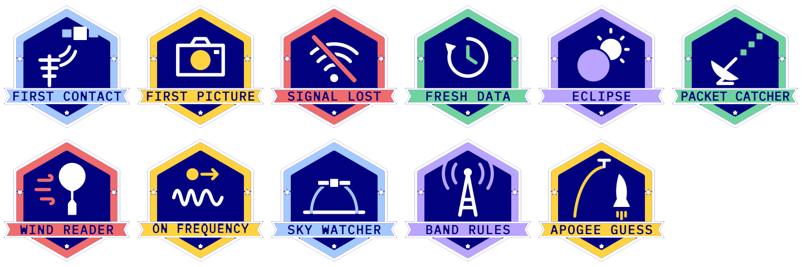

# Mission patches you can print

The 11 quest patches from the [quests page](https://cubesatclass.org/quests/), as flat three-colour prints about 75 × 73 mm and 2.8 mm thick. They're the same art as on the website: one file, [site/src/patch-art.json](../../site/src/patch-art.json), draws both.

> **Status: design-checked, not yet printed.** Every rule below is checked in code. Print the [test coupon](#print-the-coupon-first) before a full patch, and record what you find.



| Patch | Quest | File |
| --- | --- | --- |
| First contact | Make first contact | [first-contact.3mf](print/first-contact.3mf) |
| First picture | Bring back a picture | [bring-back-a-picture.3mf](print/bring-back-a-picture.3mf) |
| Signal lost | Lose the signal on purpose | [lose-the-signal.3mf](print/lose-the-signal.3mf) |
| Fresh data | Fresh or historical? | [fresh-or-historical.3mf](print/fresh-or-historical.3mf) |
| Eclipse | Light and shadow | [light-and-shadow.3mf](print/light-and-shadow.3mf) |
| Packet catcher | Catch the Pass | [catch-the-pass.3mf](print/catch-the-pass.3mf) |
| Wind reader | Rockoon Battle | [rockoon-battle.3mf](print/rockoon-battle.3mf) |
| On frequency | Follow the Doppler shift | [follow-the-doppler.3mf](print/follow-the-doppler.3mf) |
| Sky watcher | Predict a space station pass | [predict-a-pass.3mf](print/predict-a-pass.3mf) |
| Band rules | Who may transmit? | [who-may-transmit.3mf](print/who-may-transmit.3mf) |
| Apogee guess | Predict a rocket flight | [predict-a-rocket.3mf](print/predict-a-rocket.3mf) |

Previews of each are in [preview/](preview/).

## How it's built

Each patch is one part in three colours, stacked by height:

| Height | Colour | What it is |
| --- | --- | --- |
| 0 – 1.6 mm | Navy | The body: the hexagon and the ribbon. The patch name is cut down to it, so the name shows navy |
| 1.6 – 2.2 mm | The quest's colour | The band round the edge, the ribbon, and coloured parts of the icon |
| 1.6 – 2.8 mm | White | The keyline, the stars, the ribbon's edge and the icon. It stands 0.6 mm proud |

The tone and white bodies never overlap, and both stand on the navy body, so nothing prints on air.

## Print it

Print flat, top face up, with no supports. PLA is fine: patches live indoors.

**Multi-colour printer (for example a Bambu AMS):** open the 3MF. It holds three bodies, `body`, `tone` and `white`. Give each its filament: navy, the quest's colour (listed in `patch-art.json`), and white.

**Single-colour printer:** load all three bodies as one object, and add two filament changes:

1. Start in navy.
2. At **1.6 mm**, change to the quest's colour.
3. At **2.2 mm**, change to white.

With 0.2 mm layers those are the first layers above 1.6 mm and 2.2 mm. The white parts show a thin stripe of the quest's colour round their sides. That's expected.

## Print the coupon first

[coupon-label-and-features.3mf](print/coupon-label-and-features.3mf) is a strip about 75 × 27 mm with the longest patch name (Packet catcher) cut into a ribbon, and four bars 0.6, 0.8, 1.0 and 1.2 mm wide: two white, two in the band colour.

Print it with the same filament, nozzle and settings as the patches. Check that:

- every letter of the name is open and readable, including the inside of each A;
- the 0.8 mm bars printed whole, and the 0.6 mm bar shows where your printer's limit is.

Record what you found. If letters close up, raise `min_gap_mm` or `cap` in `patch-art.json`. If a bar is missing, raise `min_feature_mm`. Then rebuild.

## Rules, and the checks that enforce them

From the [hardware design guide](../DESIGN-GUIDE.md), adapted to a flat patch:

- **No loose pieces:** each patch is one part. The checks fail if the body is in more than one piece.
- **Prints on any printer, no supports, one big flat face:** every colour stands on the body. The checks fail if any colour overhangs it.
- **Nothing too thin:** every colour region is rounded to the 0.8 mm the printer can make. The checks fail if that rounding would remove more than a sharp tip (more than 30% of any piece, or 2% of a colour), or if a stroke is drawn thinner than 0.8 mm.
- **The name stays readable:** the cuts that form the letters are at least 0.5 mm wide, the letters are at least 3 mm tall, and the name stays on the ribbon.
- **Clean solids:** every body is a closed, watertight mesh, and no two bodies share space.
- **Reproducible:** the 3MF files are the same byte for byte on every run.

## Change a patch

1. Edit its art in [site/src/patch-art.json](../../site/src/patch-art.json). Each shape is a `stroke` or `fill` on the `white` or `tone` layer; `gap` cuts a navy outline round it. A patch's name comes from its quest's `patch:` field.
2. Rebuild, from the repository root:

   ```sh
   (cd site && npm ci)          # once: the label font comes from the site's IBM Plex Mono
   pip install shapely trimesh mapbox_earcut svgelements fonttools brotli matplotlib
   python3 hardware/patches/gen/patches.py build
   ```

   It writes `site/src/patch-shapes.json` (the frame and label outlines the website draws), the 3MF files and the previews, then runs the checks. `check` instead of `build` runs the checks and reports stale files without writing anything.
3. `cd site && npm test` fails if a quest's patch name changed without a rebuild.
