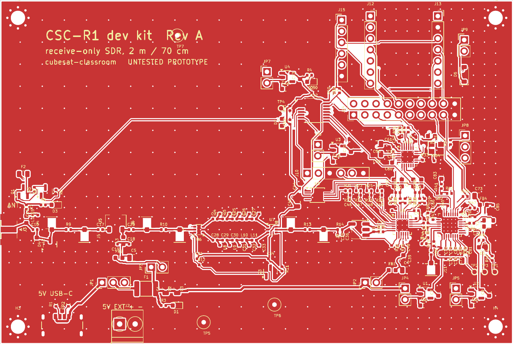

# CSC-R1 dev kit, Rev A

Receive-only SDR development kit for the 2 m and 70 cm amateur satellite bands (144–146 MHz, 435–438 MHz), built around a Seeed XIAO.

Part of the [cubesat-classroom hardware](../README.md). Results here are **desk design only**: nothing has been built or measured.

**Status: designed and rule-checked. Not built, not tested, not reviewed by an RF engineer. Do not order boards before working through "Review findings" below.**

Date: 25 November 2026. Tool: KiCad 7.0.11.

## What is in this package

| Path | What it is |
| --- | --- |
| `kicad/csc-r1.kicad_pro`, `.kicad_sch`, `.kicad_pcb` | KiCad 7 project. Import these into Flux. |
| `kicad/CSC_R1.kicad_sym`, `kicad/sym-lib-table` | Project symbols for the LTC5584, TLV320ADC3140 and PE4259 |
| [`kicad/csc-r1-schematic.pdf`](kicad/csc-r1-schematic.pdf) | Schematic. Nets are joined by label name, not by drawn wires. |
| [`kicad/csc-r1-layout-top.pdf`](kicad/csc-r1-layout-top.pdf), [`kicad/csc-r1-top.png`](kicad/csc-r1-top.png) | Top copper and silkscreen |
| `fab/gerbers/` | Gerbers for 4 copper layers, mask, paste, silk, outline, and the drill file |
| [`fab/csc-r1-bom.csv`](fab/csc-r1-bom.csv) | Bill of materials (98 lines, 205 fitted parts, 4 not fitted) |
| `fab/csc-r1-cpl-top.csv` | Pick-and-place positions. All parts are on the top side. |
| [`fab/drc-report.txt`](fab/drc-report.txt) | KiCad design rule check report |
| `gen/` | The Python that generates everything. `gen/build.sh` rebuilds it all. |

## The design

Signal chain: SMA → bias tee → PGA-103+ LNA → band filters (2 m or 70 cm, switched by two PE4259) → balun → LTC5584 I/Q demodulator → RC filter → TLV320ADC3140 ADC → I²S → XIAO.

The local oscillator is an ADF4351 with a 25 MHz TCXO. An MCP4728 DAC drives the demodulator's four trim pins. A TCA9534 expander drives the band switch, bias tee and enables.

- **Board:** 116 × 78 mm, 4 layers, 1.6 mm. Layer 2 is an unbroken ground plane. Minimum track 0.2 mm, minimum clearance 0.16 mm, vias 0.6/0.3 mm, thermal vias 0.2 mm drill.
- **Power:** 5 V from USB-C or a screw terminal, selected by jumper. Use a supply of at least 1.5 A. Four LP5907 3.3 V regulators (VCO, PLL, ADC, digital).
- **I²C addresses:** ADC 0x4C, DAC 0x60, expander 0x20.

### Dev-kit features

- Three RF break points (antenna/LNA, LNA/filters, filters/demodulator). Each is a 0 Ω link with a U.FL on each side.
- U.FL monitor port on the synthesizer's second output.
- Six current-measurement jumpers, one per supply rail.
- 2×10 controller header. With shunts fitted, the XIAO drives the kit. With shunts removed, any other controller can be wired to the odd pins.
- Baseband test header (I+, I−, Q+, Q−), test points on VTUNE, lock detect and PDBRF, LEDs for power, 3.3 V, PLL lock, bias tee and user.

### XIAO pins

| XIAO pin | Signal |
| --- | --- |
| D0, D1, D2 | I²S bit clock, frame sync, data from ADC |
| D3 | Synthesizer MUXOUT (lock detect) |
| D4, D5 | I²C SDA, SCL |
| D8, D9, D10 | Synthesizer CLK, LE, DATA |
| D6 | Optional ADC master clock (jumper), else spare |
| D7 | Spare |

### Expander bits (TCA9534)

| Bit | Signal | Default at power-up |
| --- | --- | --- |
| P0 | BAND_SEL: low = 2 m, high = 70 cm | 2 m |
| P1 | BIAS_EN: bias tee on | off |
| P2 | DEMOD_EN | off |
| P3, P4 | DEMOD_EDC, DEMOD_EIP2: enable the trim inputs | off |
| P5 | ADC_SHDNZ: high = ADC running | shut down |
| P6 | PLL_CE | on |
| P7 | User LED, active low | off |

## What was checked

| Check | Tool | Result |
| --- | --- | --- |
| Schematic netlist equals the design source | KiCad netlist export, compared by script | 142 nets, 220 parts, 0 mismatches |
| Every symbol pin has a footprint pad | script | 0 problems |
| Board pads equal the schematic netlist | KiCad netlist vs board, compared by script | 220 footprints, 0 mismatches |
| Design rule check | KiCad DRC | 0 unconnected, 0 clearance, 0 shorts, 0 courtyard overlaps |
| Remaining DRC items | KiCad DRC | 5 edge-clearance errors, all on the SMA edge connector's pads, which sit on the board edge by design |

DRC categories set to "ignore": silkscreen overlaps and text size, and library-footprint comparison. The silkscreen has not been tidied.

Pin tables were taken from manufacturer datasheets (LTC5584, TLV320ADC3140, ADF4351, PE4259, TC1-1-13M+, PGA-103+). The other parts use KiCad's library symbols.

## Review findings

### Fix or confirm before ordering

1. **No RF engineer has reviewed this layout.** Everything except the RF path was routed by a small maze router written for this board (`gen/route.py`). It obeys clearances but knows nothing about noise coupling. The lines to check by eye are VTUNE, the reference clock, the baseband pairs and the I²S clocks.
2. **ADC decoupling values are from memory, not the datasheet.** AREG and DREG have 10 µF + 0.1 µF. VREF has 1 µF (the datasheet does state a 1 µF minimum for VREF). Confirm AREG and DREG against the TLV320ADC3140 typical-application figure.
3. **ADC master mode is unconfirmed.** The board lets the ADC generate the I²S clocks from a 24.576 MHz oscillator. The datasheet lists that clock frequency, but I could not confirm 192 kHz in master mode. If it isn't supported, move the MCLK jumper and let the controller supply the clocks.
4. **LTC5584 input matching is not populated.** The datasheet gives L6 = 15 nH at 450 MHz and 68 nH at 140 MHz, but I could not read where it sits in the network from the datasheet text. The board has a π-pad footprint and a differential-shunt footprint. Check Figure 4 of the datasheet and fit accordingly.
5. **LO port has no matching.** The ADF4351 drives the LTC5584's LO pins differentially through 51 Ω pull-ups and 10 nF capacitors. The datasheet's LO matching parts are not on the board. The LO polarity is swapped on purpose to avoid a crossing; firmware must account for the sign of Q.
6. **PLL loop filter is calculated, not simulated.** 18 nF, 180 Ω + 120 nF, 390 Ω, 1.5 nF for about 20 kHz bandwidth at 2.5 mA charge-pump current. Run it through ADIsimPLL.
7. **Band filters are calculated, not measured.** Fifth-order Butterworth high-pass plus low-pass per band, from E12 values. Modelled results with Q = 40 inductors:
   - 2 m path: 2.1 dB loss in band, −36 dB at 437 MHz, but only −8 dB at 100 MHz and −13 dB at 88 MHz. FM broadcast rejection is weak.
   - 70 cm path: 2.1 dB loss in band, −37 dB at 146 MHz, −50 dB at 108 MHz.
8. **5 V headroom is thin.** The LTC5584 needs at least 4.75 V. After the fuse, ferrite and tracks, a weak USB supply may fall below that. Measure it; use the screw terminal with 5.0–5.2 V if needed.
9. **Footprint land patterns to confirm against package drawings:** LTC5584 (exposed pad drawn 2.6 mm; the UF24 package pad is about 2.45 mm), the TCXO (generic 2.5 × 2.0 mm, 4-pad) and the SMA edge connector (for 1.6 mm board thickness).
10. **50 Ω track width is assumed.** RF tracks are 0.35 mm for a roughly 0.2 mm dielectric to layer 2. Check it against the board maker's stackup calculator. The runs are a few millimetres long, so the error matters little at these frequencies.

### Known gaps against the earlier plan

- No shield-can footprints. There is free board area around the synthesizer and demodulator, but no frames.
- No LNA bypass switch and no external-LO input. Use the U.FL break points instead.
- The LO monitor port is a U.FL, not an SMA.
- The expander's outputs are not on a header.
- The top-left third of the board is empty. A Rev B could be about 100 × 60 mm.
- No ESD protection on the USB-C input. No reverse-polarity protection on the screw terminal.
- Noise: with the ADC gain at 0 dB, the ADC's own noise will probably dominate. Expect to run 20–30 dB of ADC gain. A baseband amplifier may be needed in Rev B.

### Not done

- Firmware. None is written.
- Any measurement. Nothing here has been powered.
- Certification.

## Bring-up order

1. Fit no XIAO. Remove all six current jumpers. Apply 5 V and check for shorts.
2. Fit the 3V3_DIG jumper, then the others one at a time, measuring current through each.
3. Fit the XIAO. Scan I²C: expect 0x20, 0x4C (after ADC_SHDNZ goes high) and 0x60.
4. Program the ADF4351 for 437 MHz. Check the lock LED and the LO monitor port with a spectrum analyzer. Repeat at 145.8 MHz.
5. Enable the demodulator. Inject a signal at break point 3 and look at the baseband header with a scope.
6. Start the ADC, capture I/Q, and check for the injected tone.
7. Refit the links, then measure sensitivity at 145.8 and 437 MHz against an RTL-SDR Blog V3.
8. Look for spurs near 440 MHz (the XIAO's 40 MHz crystal, 11th harmonic).

## Rev B: satellite stompbox

The plan for a pedal-enclosure version with knobs, a footswitch and an audio output is in [rev-b-pedal-plan.md](rev-b-pedal-plan.md).

## Rebuilding

`gen/build.sh` regenerates the schematic, placement, routing, pours and checks from `gen/design.py`. It needs KiCad 7 with its Python module (on Ubuntu 24.04: `apt-get install kicad kicad-symbols kicad-footprints`). Routing takes about half a minute per pass and repeats until every net connects. The Gerbers, drill, BOM and placement files in `fab/` were exported with `kicad-cli` from the board in `kicad/`.

The router is randomised by the order nets fail in, so a rebuild gives a different but equally checked layout. Commit a rebuild only after reviewing it.
