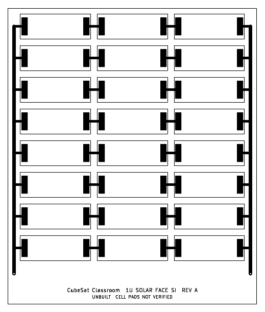
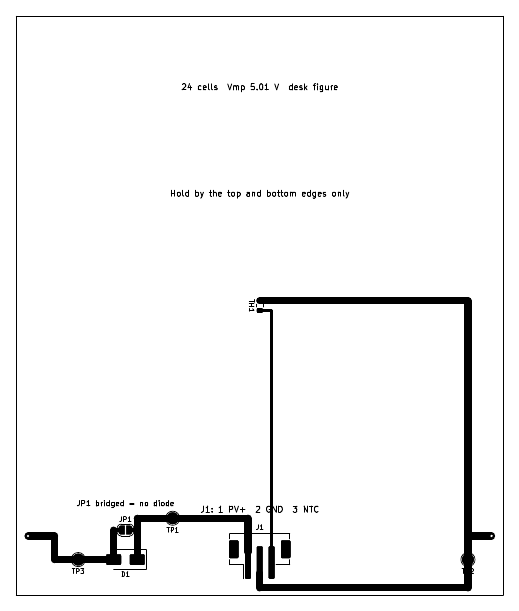
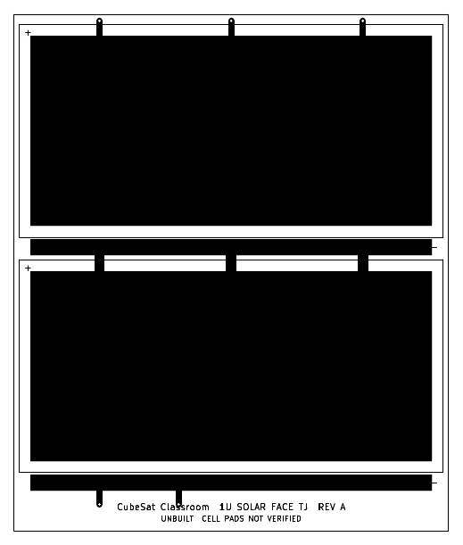
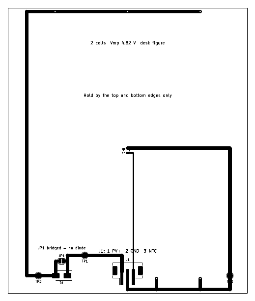

# 1U solar face, Rev A

One circuit board for the side of a 1U CubeSat, in two versions that differ only in their cells. Students learn one board. A face for the bench carries cheap silicon cells, and a face for a flight carries space cells on the same outline, with the same connector and the same back.

> **Status: designed and rule-checked. Not built, not tested, not reviewed by a solar-array engineer.** Neither cell's land pattern has been checked against the maker's drawing yet, so the build refuses to write Gerbers (see [Before you order](#before-you-order)). Every figure below is a desk figure from the makers' data, not a measurement.

| | Silicon face (`si`) | Triple-junction face (`tj`) |
| --- | --- | --- |
| For | The bench, ground stations, balloon and rocket flights | A flight-style panel: practice now, orbit later |
| Cells | 24 × ANYSOLAR KXOB25-05X3F, 8 strings of 3 | 2 × AZUR SPACE 3G30A-Advanced 8 × 4 cm assemblies, in series |
| Maximum-power point (desk figure) | 5.01 V, 147 mA, 0.74 W at 1000 W/m² | 4.82 V, 503 mA, 2.42 W in sunlight in orbit (AM0, 28 °C, new) |
| Open-circuit voltage (desk figure) | 6.21 V | 5.40 V |
| Cell cost | about $61–75 (DigiKey, Nov 2026) | about $600–1,100 (space cells cost $250–450 per watt) |
| How cells go on | Surface mount: reflow or hot air (mentor step) | Bonded with silicone adhesive; the interconnectors are welded or soldered to the board (mentor step) |

Both strings make about 5 V at maximum power, so the same logger, charger or power board takes either face.






## The board

- **Size:** 82.5 × 98 mm, 1.6 mm FR-4, two layers. That's the usual size of a 1U side panel. It fits between the rails of a CubeSat built to the CubeSat Design Specification, and inside the side of the [AMSAT CubeSatSim frame](../amsat-cubesatsim/README.md), whose outside is 100 × 113.5 mm.
- **Front:** cells only.
- **Back:** everything else, all surface mount, so nothing pokes through under the cells:

| Part | What it does |
| --- | --- |
| J1, JST PH 3-pin (B3B-PH-SM4-TB) | 1 PV+, 2 GND, 3 NTC. Mates with a PHR-3 housing |
| D1, SS14 Schottky | Blocking diode: in the dark, a battery or charger can't push current back into the cells |
| JP1, solder jumper | Open: the diode is in. Bridge it with solder to measure the cells without the diode's drop |
| TH1, 10 kΩ NTC (Murata NCP18XH103F03RB) | Temperature behind the cells. Cell voltage falls as they warm. Your reader supplies the pull-up resistor |
| TP1, TP2, TP3 | Test pads: PV+ after the diode, GND, and the cells before the diode |

On the silicon face, each row is one string of three cells. If a row is shaded, the others keep working. Ask the class why that happens and what a bypass diode would add. The triple-junction assemblies have a bypass diode built in.

**Holding it:** the board is held by its top and bottom edges only. No cell comes within 1 mm of those edges, so printed lips like the ones on the [payload plate](../amsat-cubesatsim/README.md) can clamp it there. That printed mount isn't designed yet. When it is, it follows the hardware design guide (`hardware/DESIGN-GUIDE.md`, in [PR #60](https://github.com/steelhead99x/cubesat-classroom/pull/60)): no loose pieces, one way round, and a coupon first. A metal flight structure would add mounting holes to suit its own rails.

## Before you order

The build writes Gerbers only when the board's cells have `verified=True` in [gen/cells.py](gen/cells.py). Until then, `fab/<variant>/NOT-FOR-FAB.txt` explains what's missing:

- **Silicon:** the two pads are placeholders at the ends of the cell. Copy the land pattern from the ANYSOLAR KXOB25-05X3F data sheet.
- **Triple junction:** the footprint assumes the rear contact is + and the welded interconnectors lie along one long edge. Check both against the AZUR drawing (data sheet HNR 0003401-01-01) before bonding cells or ordering boards. Getting the polarity backwards puts both cells in reverse.

When a footprint is fixed, change it in [gen/footprints.py](gen/footprints.py), set `verified=True` in `cells.py`, and run the build again.

## Build it

Needs KiCad 7 (`kicad-cli` and its Python `pcbnew` module).

```sh
hardware/solar-face/gen/build.sh
```

For each face, the build:

1. writes the cell footprints and the schematic from [gen/design.py](gen/design.py)
2. checks KiCad's netlist against the design
3. places and routes the board
4. checks every pad against the schematic, and checks the mechanical rules: cells on the front, all other parts surface-mount on the back, nothing off the board, and cells clear of the edges the lips hold
5. runs KiCad's design-rule check, which must find no errors and nothing unconnected
6. renders the pictures above, then writes the BOM, the schematic PDF and (once verified) the fab files

It stops at the first failure, before anything is exported.

## Bench test

The quest [Measure a 1U solar face](../../quest/m1/solar-face-bench.md) takes a silicon face from sunlight to a power curve, using the INA226 logger from the [receiver bench kit](../sdr-receiver/bench/README.md).

## Where it's going

This is step 1 and step 2 of the [solar cost plan](../../docs/solar-plan.md): one board, two kinds of cells. Step 3 is flying the triple-junction face on a rideshare. That's a whole spacecraft's worth of testing, and the launch slot is the long-lead item.

## Sources

- AZUR SPACE 3G30-Advanced data sheets, including HNR 0003401-01-01 (3G30A 8 × 4 cm CIC): Voc 2.70 V, Vmp 2.409 V, Imp 502.9 mA, beginning of life, AM0.
- ANYSOLAR KXOB25-05X3F, DigiKey listing: 23 × 8 × 1.8 mm, Voc 2.07 V, Vmp 1.67 V, Imp 18.4 mA, 30.7 mW; $3.14 each, or $2.56 each for 10 or more.
- University of Surrey review in Acta Astronautica (2025): triple-junction space cells cost $250–450 per watt.
- The generator is adapted from the [CSC-R1 receiver's](../sdr-receiver/README.md) (`sexp.py` and `symlib.py` are copied unchanged).
